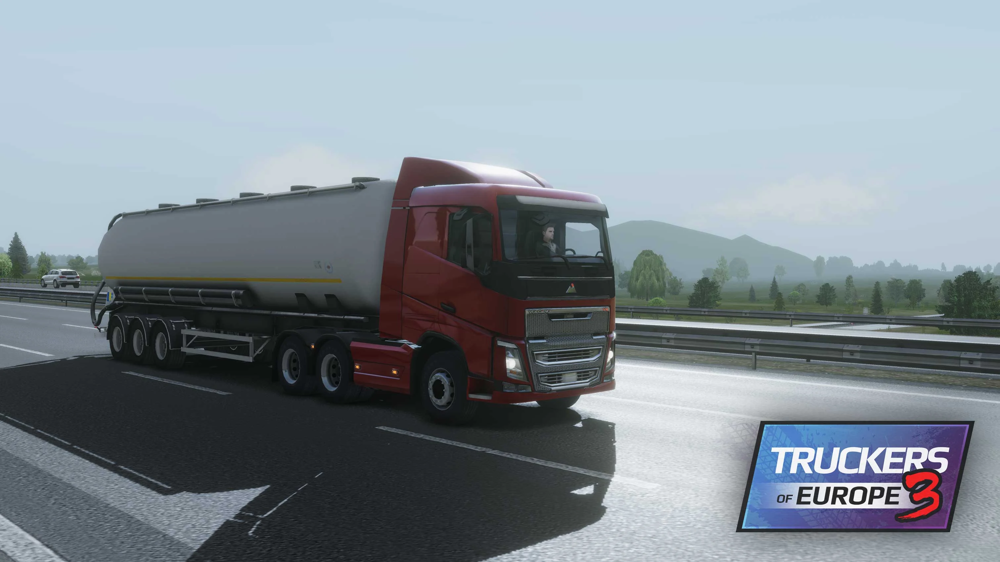
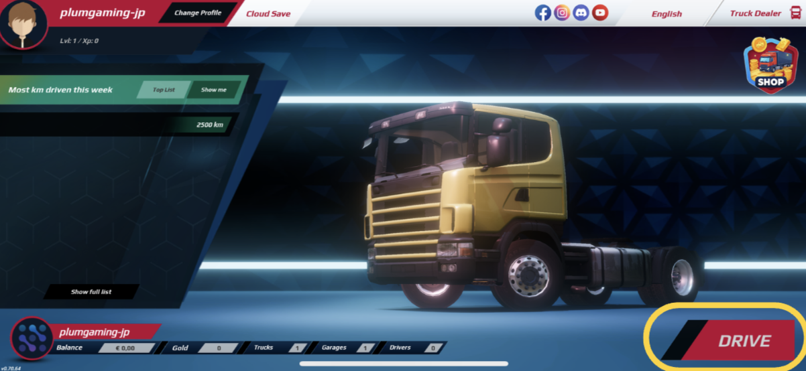
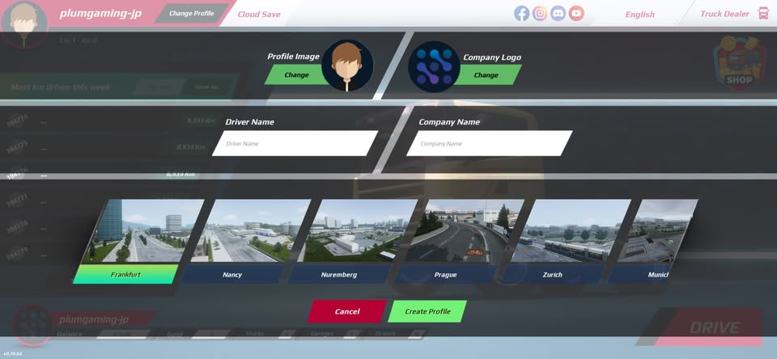
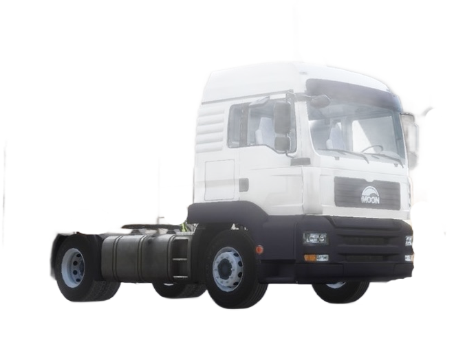
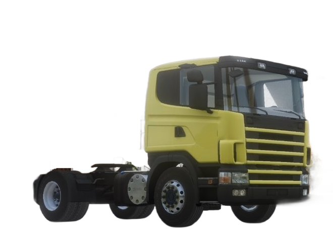



[Japanese Ver](/getting-started/how-to-start/)

# What Is Truckers of Europe 3?
Truckers of Europe 3 is a realistic truck driving simulation game developed by Wanda Software  
for smartphones (Android/iOS) and PC.  
It’s free-to-play yet offers high-quality graphics and an authentic experience.  
* Multiplayer support is available starting with the latest version.

___
## Download the App

- [App Store (iPhone, iPad)](https://apps.apple.com/jp/app/truckers-of-europe-3/id1630315603)
- [Google Play (Android)](https://play.google.com/store/apps/details?id=com.WandaSoftware.TruckersofEurope3)
- Price: Free

> Also compatible with Windows and Mac  
> (you can play Windows 10 or 11 [Google Play (Windows)](https://play.google.com/store/apps/details?id=com.WandaSoftware.TruckersofEurope3)  
> or Mac with macOS 12.0 or later and models equipped with an Apple M1 or later chip [App Store (Mac)](https://apps.apple.com/jp/app/truckers-of-europe-3/id1630315603))

___
## What to Do When You First Launch the App

Tap “Drive” in the lower-right corner of the screen to create your profile.  

- Choose a profile picture
- Choose a company logo
- Set your username and company name
- Choose your initial garage (base) from among 9 cities  

> ⚠️Note: Once you’ve set your profile (excluding the garage), you cannot change it again. (You can just delete or add profiles to create up to two new ones.)

___
## Choosing a Garage (Base)

Since the initial garage is the only one you can obtain for free, choosing it wisely is very important.
**Nuremberg, located in the center of the map with access to many cities, is recommended as your first garage**.

For detailed differences between garages, please refer to the [Garages & Map](/en/garages-map/).

___
## Choosing Your First Truck

With your starting funds of €10,000, you can purchase only two trucks.

| Image | Truck Name | Price | Horsepower | Torque |
|---|---|---|---|---|
|  | Moon THA | €9,000 | 310 hp | 1,550 Nm |
|  | Stream RT Legend 1995 | €10,000 | 380 hp | 1,900 Nm |

___
## Recommended: Stream RT Legend 1995

Since it offers higher horsepower and torque for just a €1,000 difference, this is the recommended choice for your first truck.

> The Moon THA is also not recommended because it has fewer upgrade and customization options.

For detailed differences between each truck, please refer to the [Truck Encyclopedia (Details)](/en/vehicles/truck/).

___
## First Steps

Congratulations.Once you’ve completed the steps above, you can start working right away!

[Your First Job](/en/getting-started/first-job/)
