

[Japanese Ver](/jobs/job-list/)

# List of Observed Jobs

To examine the trends and list of jobs in this game, we collected approximately 3,000 job data entries for this article.
On this page, we’ll take a deeper look at the jobs in this game based on the data obtained from this collection.

Scope of the Survey: 9 cities with garages, 2,889 entries, no owned trailers, Version 0.70.64, Survey Date: October 28, 2026


This list includes all job types observed during actual gameplay. Since this is not based on an analysis of game files, we cannot definitively rule out the existence of jobs that occur under special conditions or with low probability (such as intended features or bugs), and there may be jobs not included in this list.
The reward multiplier is calculated relative to the base reward for jobs with the same origin > destination (median value for jobs with a weight of 40 t or less and a required level other than Level 30).


* Indicates a provisional value based on fewer than 5 observations.

“Required Trailer” refers to the trailer you must own to accept the corresponding job.
You can accept a job even if you do not own any trailers.
(This section is currently under verification and has not been filled in. Thank you for your understanding.)

## ① Under 40 t (observed up to 39 t)

| Cargo | Required level | Weight | Reward multiplier |
|---|---|---|---|
| Clothes 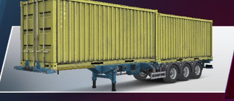 | None | 8–15 t | ≈1.00 |
| Medicine 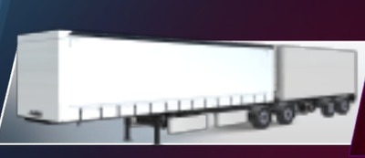 | None | 9–12 t | ≈1.00 |
| Vegetables 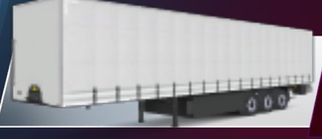 | None | 9–19 t | ≈1.00 |
| Fruits 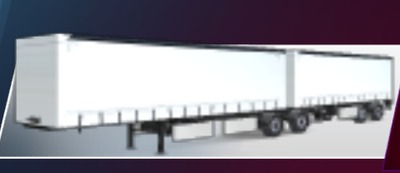 | None | 9–20 t | ≈1.00 |
| Canned Food  | None | 9–23 t | ≈1.00 |
| Beverages  | None | 11–21 t | ≈1.00 |
| Food  | None | 12 t | ≈1.00 |
| Books 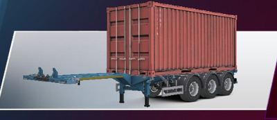 | None | 12–14 t | ≈1.00 |
| Ice Cream 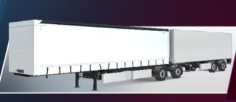 | None | 13 t | ≈1.00 |
| Fruit Juice  | None | 13 t | ≈1.00 |
| Marble 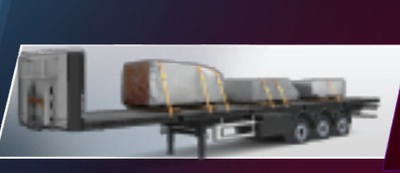 | None | 13–18 t | ≈1.00 |
| Milk  | None | 14 t | ≈1.00 |
| Rebar 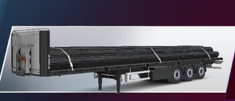 | None | 15 t | ≈1.00 |
| Car Parts 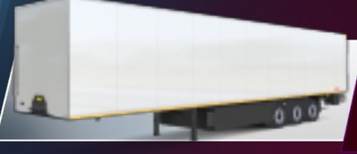 | None | 16–26 t | ≈1.00 |
| Vegetable Oil  | None | 17 t | ≈1.00 |
| Meat 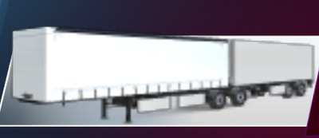 | None | 18 t | ≈1.00 |
| Fish  | None | 18 t | ≈1.00 |
| Metal Pipes 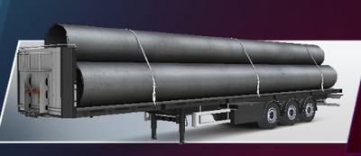 | None | 18 t | ≈1.00 |
| Wooden Planks 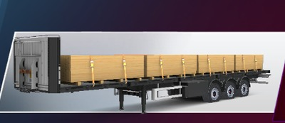 | None | 19 t | ≈1.00 |
| Glucose 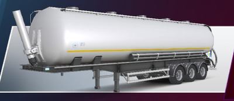 | None | 19 t | ≈1.00 |
| Gypsum Bags 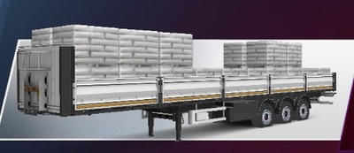 | None | 19 t | ≈1.00 |
| Concrete Blocks 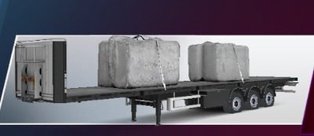 | None | 19 t | ≈1.00 |
| Fertilizer Bags 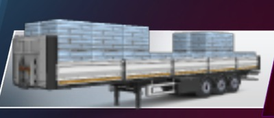 | None | 20 t | ≈1.00 |
| Cheese  | None | 21 t | ≈1.00 |
| Electronics 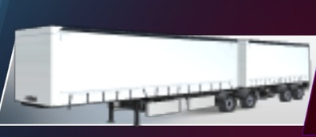 | None | 21 t | ≈1.00 |
| Cement Bags 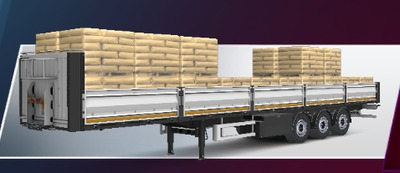 | None | 23 t | ≈1.00 |
| Concrete Barriers 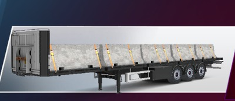 | None | 26 t | ≈1.00 |
| Cable Reels 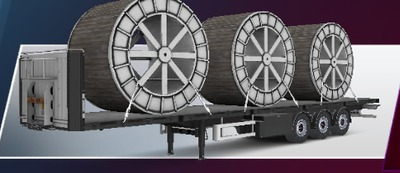 | None | 29 t | ≈1.00 |
| Boiler 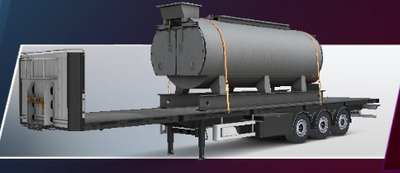 | None | 34 t | ≈1.00 |
| Gypsum Bags  | 2 | 12–17 t | ≈1.00 |
| Coal  | 2 | 14 t | ≈1.00 |
| Sand 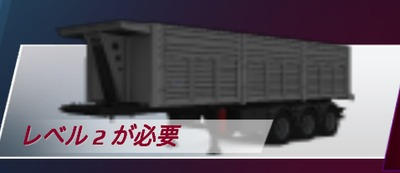 | 2 | 15 t | ≈1.00 |
| Concrete Blocks  | 2 | 15 t | ≈1.00 |
| Paving Stones 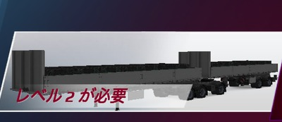 | 2 | 15–22 t | ≈1.00 |
| Gravel  | 2 | 16 t | ≈1.00 |
| Scrap Metal 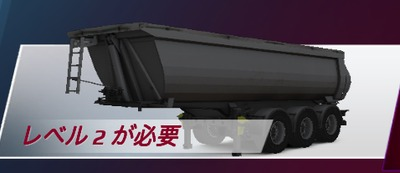 | 2 | 17 t | ≈1.00 |
| Machine Parts 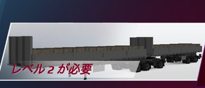 | 2 | 18–26 t | ≈1.00 |
| Cement Sacks 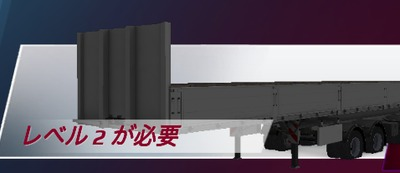 | 2 | 20–25 t | ≈1.00 |
| Stones 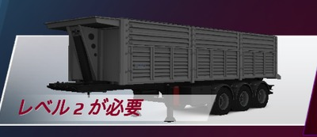 | 2 | 21 t | ≈1.00 |
| Bricks 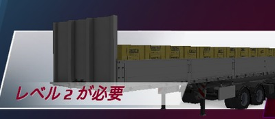 | 2 | 25–32 t | ≈1.00 |
| Arsenic  | 3 | 8–16 t | ≈1.00 |
| Contaminants 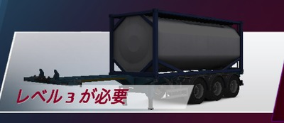 | 3 | 9–18 t | ≈1.00 |
| Chloride  | 3 | 9–19 t | ≈1.00 |
| Pesticides  | 3 | 10–15 t | ≈1.00 |
| Medical Waste 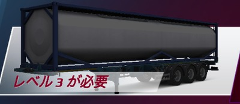 | 3 | 10–18 t | ≈1.00 |
| Oil  | 3 | 15 t | ≈1.00 |
| Cyanide  | 3 | 16–17 t | ≈1.00 |
| Fuel Oil  | 3 | 18 t | ≈1.00 |
| Gasoline  | 3 | 21 t | ≈1.00 |
| Diesel 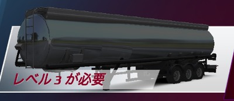 | 3 | 24 t | ≈1.00 |
| Cement 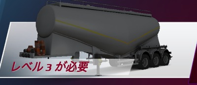 | 3 | 25 t | ≈1.00 |
| Logs 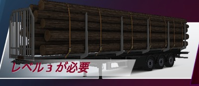 | 3 | 26 t | ≈1.00 |
| Cyanide  | 4 | 7 t | ≈1.00 |
| Glass 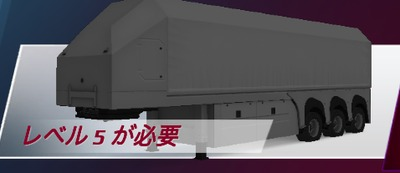 | 5 | 14 t | ≈1.00 |
| Cement  | 5 | 14 t | ≈1.00 |
| Skid Steer 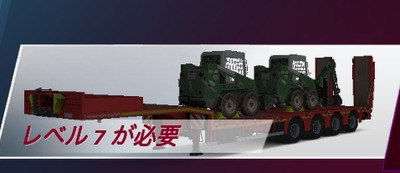 | 7 | 14–16 t | ≈1.00 |
| Motor Grader 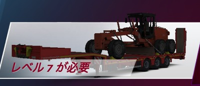 | 7 | 18 t | ≈1.00 |
| Excavator 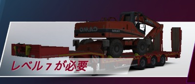 | 7 | 25–27 t | ≈1.00 |
| Crane Truck 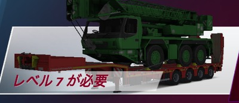 | 7 | 38 t | ≈1.00 |
| Front Loader 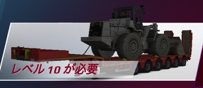 | 10 | 28 t | ≈1.00 |
| Asphalt Paver 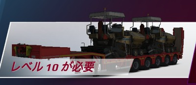 | 10 | 35 t | ≈1.00 |
| Excavator  | 12 | 26 t | ≈1.00 |
| Generator Parts 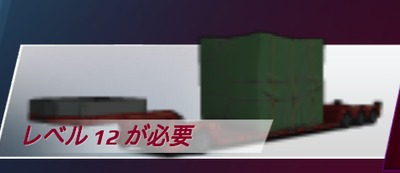 | 12 | 37 t | ≈1.00 |
| Machine Parts  | 12 | 39 t | ≈1.00 |
| Industrial Silo 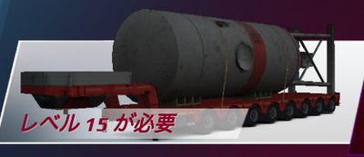 | 15 | 19–21 t | ≈1.00 |
| Heavy Tractor 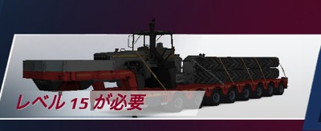 | 15 | 35 t | ≈1.00 |
| Turbine Motor 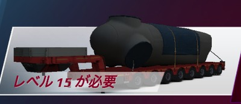 | 15 | 36 t | ≈1.00 |

___

## ② Over 40 t

| Cargo | Required level | Weight | Reward multiplier |
|---|---|---|---|
| Road Roller 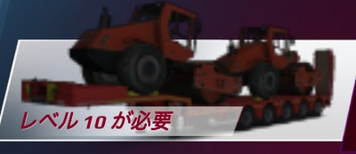 | 10 | 41 t | ≈1.83 |
| Machine Parts  | 10 | 45 t | ≈1.90 |
| Articulated Truck 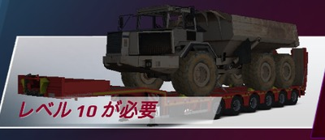 | 10 | 53 t | ≈1.99 |
| Car Parts  | 12 | 42–49 t | ≈1.84–1.99 |
| Generator Parts  | 12 | 42–55 t | ≈1.85–1.99 |
| Machine Parts  | 12 | 47–62 t | ≈1.94–1.99 |
| Cable Reels  | 12 | 82 t | ≈1.99 |
| Mining Truck Parts 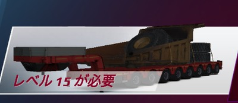 | 15 | 63 t | ≈1.99* |
| Wagon 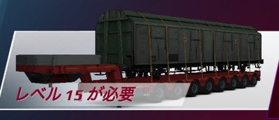 | 15 | 72–76 t | ≈1.99–2.00 |
| Wagon  | 17 | 128 t | ≈2.00 |

___

## ③ Required level 30

| Cargo | Required level | Weight | Reward multiplier |
|---|---|---|---|
| Agricultural Machinery 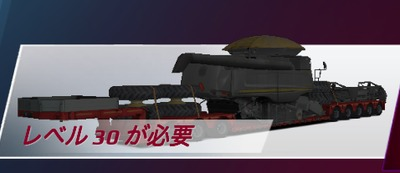 | 30 | 23 t | ≈1.40 |
| Heavy Crane 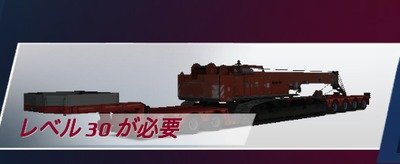 | 30 | 42 t | ≈2.59* |
| Transformer  | 30 | 49 t | ≈2.74* |
| Mining Truck Chassis  | 30 | 53 t | ≈2.81* |
