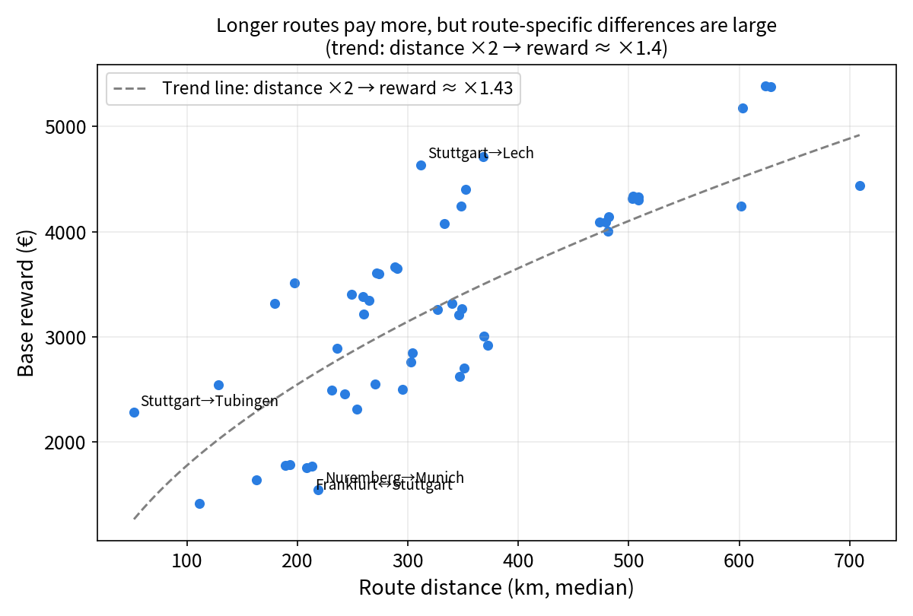
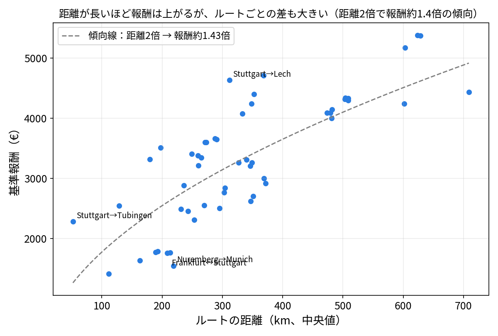
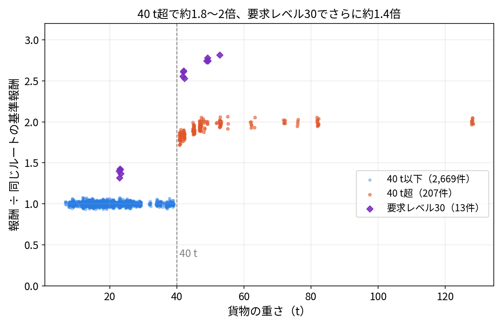
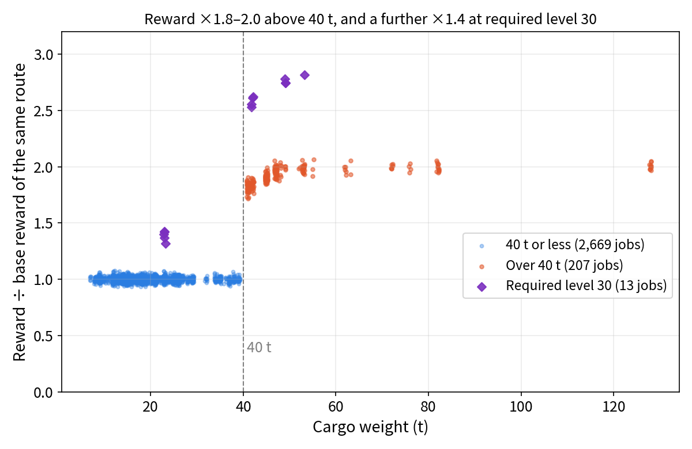



[Japanese Ver](/jobs/reward-mechanics/)

# How Job Rewards Are Determined  - Findings from Our Independent Analysis of Approximately 3,000 Jobs -

On this site, we independently analyzed 2,889 jobs to investigate the characteristics of jobs in this game and every existing job type.
This page explains the rules governing job rewards based on the findings from this independent analysis.
 > The analysis was conducted using version 0.70.64, but specifications may change in future updates.

___

## Conclusions

- (① Rewards are almost entirely determined by the route: origin > destination)
- (② For loads weighing 40 t or less, the reward is the same regardless of the cargo or weight)
- (③ For loads over 40 t, the reward is approximately 1.8 to 2 times higher; if the required level is 30, it increases by an additional 1.4 times)

___

## Scope of the Survey

| Item | Details |
|---|---|
| Game Version | ver 0.70.64 (latest version as of November 2026) |
| Departure Points | 9 locations (Frankfurt, Milan, Munich, Nancy, Nuremberg, Prague, Stuttgart, Tremola, Zurich) |
| Number of Cases | 2,889 cases (excluding duplicates, etc., from 1,031 screenshots) |
| Trailer | None |
| Base Reward | Median reward for jobs on the same route with a weight of 40 t or less and a level requirement other than 30 |

> ⚠️ Since we were able to investigate jobs in all cities without verifying the other five cities that do not have garages,
this analysis was conducted using only the nine cities with garages.
Additionally, this analysis was performed by actually launching the game rather than analyzing game files, so it cannot be ruled out that we may have missed certain special conditions or specifications. Please note that this is solely this site’s own analysis and does not constitute official information.

___

## 1. Rewards Are Largely Determined by the Route


Data: The route alone accounts for 77.9% of reward variation; when combined with a distance exceeding 40 t, this rises to 99.3%; and at Level 30, it reaches 99.6%.
Round-trip fares are the same: The average reward ratio for similar jobs with the origin and destination swapped is 1.00 (0.95–1.03).
Distance: On a per-route basis, doubling the distance results in approximately a 1.4x increase in reward. For the same route, a 1% increase in distance for a single trip increases the reward by approximately 0.39%.
Note: There are significant individual differences between routes (e.g., Stuttgart→Tübingen is 52 km and pays €2,284).


Route alone accounts for 77.9% of the variation in rewards.
Additionally, on the same route, the reward remains the same regardless of whether it’s the outbound or return leg.
Longer distances tend to yield higher rewards; on average, doubling the distance results in a reward that is approximately 1.4 times higher, but
  
However, the reward does not increase at a strictly fixed rate; the multiplier varies significantly depending on the route.
For specific reward multipliers by route, see [Job Rewards by Route](/en/jobs/reward-mechanics/#Job-Rewards-by-Route)

<!--  -->

___

## 2. For loads weighing 40 metric tons or less, the reward is the same regardless of the cargo


Input values: Multiplier 1.00 (95% range 0.97–1.03), 2,669 cases, 61 cargo types.
Test results: Effect of cargo type (58 types): p = 0.125; correlation with weight (40 t or less): 0.03 (p = 0.42). This indicates “no significant difference was found,” not “proof that there is no difference.”
Weight Variation: 41 types of cargo with fixed weight, 28 types with variable weight (median range: 8 t).
Figure: chart_weight_vs_reward_ratio.png (For weights of 40 t or less, values cluster around 1.00)


The vast majority fall into this group: 2,669 out of 2,889 cases—90% of the total—have exactly the same reward multiplier.
For routes under 40 t, the reward is virtually the same regardless of the cargo type or weight.
> While the amount may vary by a few percent, this is likely due to random number generation.
In this analysis, this reward multiplier is used as the baseline multiplier.

<!--  -->

___

## 3. Over 40 t: Approximately 1.8–2 times

| Weight | Multiplier | Count | Cargo |
|---|---|---|---|
| 41 t | Approx. 1.83 | 33 | Road roller |
| 42 t | Approx. 1.84 | 23 | Auto parts, generator parts |
| 45 t | Approx. 1.90 | 36 | Machinery parts, auto parts |
| 47 t | Approx. 1.95 | 38 | Auto parts, machinery parts |
| 48 t or more (11 variations) | Approx. 1.97–2.00 | 77 | Generator parts, automotive parts, machinery parts, articulated trucks, mining truck parts, wagons, cable reels |


Reading: Approximately 1.83 at 41 t, rising to about 1.99 at 48 t, and then plateauing at around 2.0 thereafter (even 128 t is approximately 2.0).
Even for the same cargo type, the multiplier varies depending on weight (machinery parts, automotive parts, generator parts, cable reels).
Heavy-weight cargo accounts for 7.4% of the total (215/2,889).
Note: There is no data for exactly 40 t; the boundary lies between “40 t or less” and “41 t or more.”


  

Although these jobs make up only 7.4% of the total—a small number—
there is a significant difference in pay: jobs exceeding 40 t offer approximately double the base multiplier.
Of course, the difficulty increases with the weight, but the pay is commensurate with that difficulty.
Within the group exceeding 40 t, the pay multiplier does not vary significantly.
The group exceeding 40 metric tons includes jobs with a wide range of weights, from 41 to 128 metric tons, but all fell within the 1.8–2.0x range.
___

## 4. Requirement Level 30: Approximately 1.4x More

| Weight | Multiplier | Count | Cargo |
|---|---|---|---|
| 23 t | Approx. 1.40 | 5 | Agricultural Machinery |
| 42 t | Approx. 2.59 | 4 | Heavy Cranes |
| 49 t | Approx. 2.74 | 3 | Transformers |
| 53 t | Approx. 2.81 | 1 | Mining Truck Chassis |


The bonus is approximately 1.4 times (1.38–1.41 times that of a standard heavyweight of the same weight).
Note: Only 13 entries. These are listed as tentative values.


Although this group accounted for only 0.3% of the total, it had the highest reward multiplier.
Level 30 is a tier that’s difficult to reach unless you’ve played the game for a considerable amount of time, but the rewards are correspondingly much higher.
  
At most, you can earn just under three times the base reward.
> Since there were only 13 instances—a job with a very low occurrence rate—there may be some margin of error in the verification results for this group.

___

## Tips for Utilization


- Rewards plateau at 48 t or more (approx. 1.83 at 41 t, approx. 2.0 at 48 t or more)
- For loads of 40 t or less, the reward is the same for any job on the same route. The shorter the route, the higher the reward per 100 km (approx. €1,950 for 150 km or less, approx. €1,000 for 150–300 km, approx. €910 for 300–450 km, and approx. €850 for over 450 km)
- When choosing a job, focus on the route and weight rather than the type of cargo


Job pay is determined by whether the load is “40 metric tons or more” and “which route” you take.
These factors are the most important when selecting a job.
Additionally, shorter jobs tend to offer higher pay per 100 km.
You should also be mindful that jobs with excessively long distances reduce your earning efficiency.

Up to 150    km: approx. €1,950
150–300   km: approx. €1,000
300–450   km: approx. €910
Over 450       km: approx. €850

___

## Research Methodology and Limitations


Method: Screenshots were processed using OCR, the results from two engines were cross-checked, and rows requiring verification were confirmed via the images.
Limitations: Only 9 locations / No owned trailers / Categories with few entries (6 entries for Level 4, 13 for Level 30) / Values observed may not necessarily reflect the game’s design values / Multipliers when owning trailers will be verified separately.


Method: Screenshots were processed using OCR, the results from two detection engines were cross-checked, and rows requiring verification were confirmed by examining the images. These are job results based on the assumption that no trailers are owned.
Limitations: Since this is not an analysis of the game files, we cannot rule out the possibility of verification errors or inaccuracies. Please use this information for reference only.

## Job Rewards by Route

## Routes with the Highest Rewards per Distance (Top 3)

| Rank | Route | Distance (km) | Base Reward (€) | Per 100 km (€) |
|---|---|---|---|---|
| 1 | Stuttgart → Tübingen | 52 | 2,284 | 4,391 |
| 2 | Stuttgart → Quarry | 128 | 2,544 | 1,979 |
| 3 | Zurich → Quarry | 180 | 3,318 | 1,848 |

## Routes with Lowest Pay per Distance (Bottom 3)

| Rank | Route | Distance (km) | Base Pay (€) | Per 100 km (€) |
|---|---|---|---|---|
| 53 | Milan → Linz | 709 | 4,436 | 626 |
| 52 | Nuremberg → Lech | 602 | 4,242 | 705 |
| 51 | Nuremberg → Munich | 219 | 1,547 | 706 |


Data Notes (Verified: 53 routes; at least 8 distance measurements per route; at least 24 base reward entries)
- The highest reward per 100 km is approximately 7.0 times the lowest (highest: €4,391; lowest: €626). The median is €936, and the interquartile range is €854 to €1,256.
- The top rankings are skewed toward shorter routes (because the increase in pay is more gradual as distance increases; the slope per route is 0.52). The Spearman correlation between rank and distance is 0.56.
- There are also differences that cannot be explained by distance alone: The multiplier relative to the trend line is approximately 1.81 for Stuttgart→Tübingen and approximately 0.58 for Nuremberg→Munich.
- The baseline reward is the median value for jobs with a weight of 40 metric tons or less and a difficulty level of 30 or lower. Distance is the median of the actual measured values for the first job (which varies by a few percent to 20% per job). Differences in rankings among closely ranked jobs may fall within the margin of error.


## Rankings for All Routes (Sorted by Highest Reward per 100 km)

| Rank | Route | Distance (km) | Base Reward (€) | Per 100 km (€) |
|---|---|---|---|---|
| 1 | Stuttgart → Tübingen | 52 | 2,284 | 4,391 |
| 2 | Stuttgart → Quarry | 128 | 2,544 | 1,979 |
| 3 | Zurich → Quarry | 180 | 3,318 | 1,848 |
| 4 | Munich → Quarry | 198 | 3,514 | 1,779 |
| 5 | Stuttgart → Lech | 312 | 4,635 | 1,486 |
| 6 | Stuttgart → Zurich | 249 | 3,406 | 1,368 |
| 7 | Munich → Stuttgart | 272 | 3,604 | 1,327 |
| 8 | Stuttgart → Munich | 274 | 3,599 | 1,316 |
| 9 | Zurich → Stuttgart | 260 | 3,381 | 1,303 |
| 10 | Stuttgart → Airolo | 368 | 4,715 | 1,281 |
| 11 | Tremola → Stuttgart | 288 | 3,666 | 1,273 |
| 12 | Tremola → Airolo | 112 | 1,413 | 1,267 |
| 13 | Tremola → Tübingen | 265 | 3,346 | 1,263 |
| 14 | Stuttgart → Tremola | 290 | 3,648 | 1,256 |
| 15 | Tremola → Lech | 352 | 4,401 | 1,249 |
| 16 | Zurich → Tübingen | 260 | 3,218 | 1,238 |
| 17 | Tremola → Quarry | 333 | 4,080 | 1,225 |
| 18 | Zurich → Airolo | 236 | 2,887 | 1,223 |
| 19 | Zurich → Lech | 348 | 4,240 | 1,218 |
| 20 | Nuremberg → Frankfurt | 231 | 2,490 | 1,078 |
| 21 | Frankfurt → Nuremberg | 243 | 2,459 | 1,012 |
| 22 | Munich → Nuremberg | 163 | 1,636 | 1,004 |
| 23 | Munich → Lech | 327 | 3,260 | 997 |
| 24 | Munich → Tübingen | 340 | 3,314 | 975 |
| 25 | Munich → Linz | 270 | 2,552 | 945 |
| 26 | Zurich → Tremola | 189 | 1,774 | 938 |
| 27 | Zurich → Munich | 349 | 3,266 | 936 |
| 28 | Nuremberg → Prague | 304 | 2,844 | 935 |
| 29 | Munich → Zurich | 346 | 3,209 | 927 |
| 30 | Tremola → Zurich | 193 | 1,786 | 925 |
| 31 | Prague → Linz | 254 | 2,314 | 913 |
| 32 | Prague → Nuremberg | 303 | 2,763 | 912 |
| 33 | Tremola → Milan | 474 | 4,092 | 864 |
| 34 | Milan → Stuttgart | 624 | 5,382 | 863 |
| 35 | Nuremberg → Milan | 504 | 4,340 | 861 |
| 36 | Milan → Tremola | 482 | 4,144 | 860 |
| 37 | Milan → Nuremberg | 503 | 4,317 | 858 |
| 38 | Milan → Airolo | 603 | 5,173 | 858 |
| 39 | Stuttgart → Milan | 628 | 5,377 | 856 |
| 40 | Munich → Milan | 479 | 4,088 | 854 |
| 41 | Milan → Zurich | 508 | 4,330 | 852 |
| 42 | Milan → Lech | 295 | 2,502 | 848 |
| 43 | Zurich → Milan | 508 | 4,302 | 846 |
| 44 | Frankfurt → Stuttgart | 208 | 1,756 | 842 |
| 45 | Milan → Munich | 481 | 4,001 | 832 |
| 46 | Stuttgart → Frankfurt | 213 | 1,768 | 830 |
| 47 | Zurich → Nancy | 369 | 3,002 | 814 |
| 48 | Nancy → Zurich | 372 | 2,916 | 784 |
| 49 | Nancy → Frankfurt | 351 | 2,704 | 770 |
| 50 | Frankfurt → Nancy | 347 | 2,620 | 755 |
| 51 | Nuremberg → Munich | 219 | 1,547 | 706 |
| 52 | Nuremberg → Lech | 602 | 4,242 | 705 |
| 53 | Milan → Linz | 709 | 4,436 | 626 |
