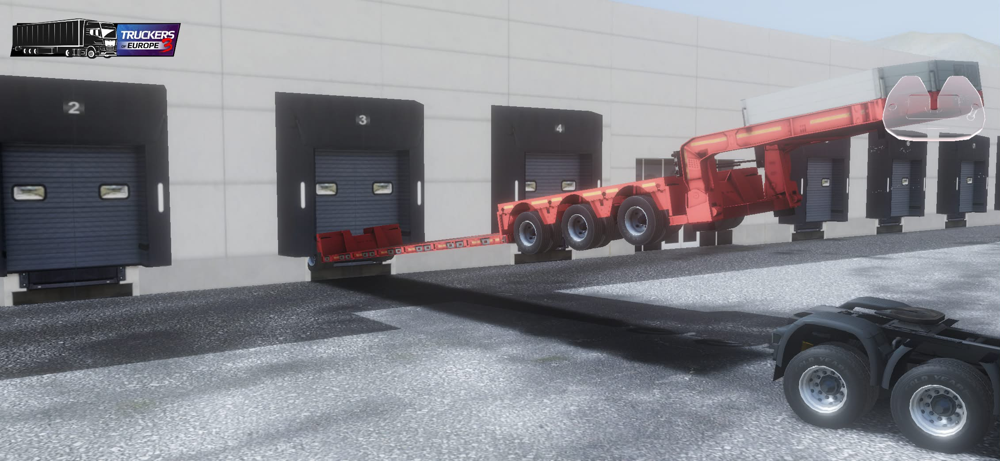



[Japanese Ver](/docs/troubleshooting/)

This category summarizes known bugs in the current version and their workarounds.  
If you encounter any bugs or issues not listed on this page, please email us via the “Contact Us” page.

___
## Getting Stuck
 
This can happen when you hit something or upon spawning.  
If you are completely stuck, using the “Towing Service” is what you need to do. 
Additionally, if using the Towing Service does not resolve the issue, (if you are in the middle of a job, cancel it first,) and then select “Go to Garage” to respawn at your own garage—this is the only solution.
If you are stuck inside a trailer, you must select “Send Trailer to Garage” instead of “Go to Garage.”

___
## Falling Through the Ground

This is particularly common during loading.  
It occurs when the truck or trailer loads before the ground does.  
While it cannot be prevented, it is harmless because you will automatically respawn on the ground after falling for a few seconds.

___
## Trailer Display Glitches

This can happen when completing a job or when you skip loading cargo.  
For example, a trailer’s “Oversize” designation might be replaced with “Lowbed,”  
or cargo that should be loaded might not display properly.  
There is no real harm caused by this.  
In both cases, the issue can be resolved by returning to the main menu or restarting the app.

---
## Towing Service

When using the towing service, you may spawn too far from your original location or leave your trailer behind.
In some cases, you may get completely stuck.
The only surefire solution is to cancel the job—even if you’re in the middle of it—select your garage, and use “Visit Garage” to return to it.

---
## Getting Lost

When using the tow service or taking a wrong turn, the map navigation may stop working properly.
If you can drive back to the original route, that’s fine, but if you’re completely lost, the surefire solution—just like with the tow service malfunction—is to use “Visit Garage” to return to your garage.
