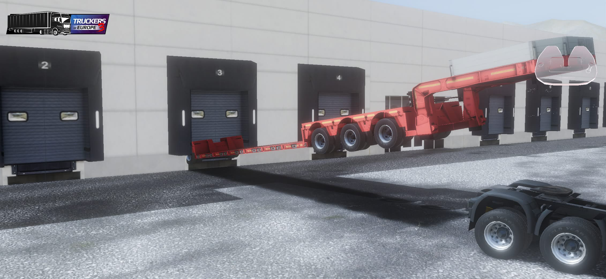



[Japanese Ver](/docs/troubleshooting/)

This category summarizes known bugs in the current version and their workarounds.  
If you encounter any bugs or issues not listed on this page, please email us via the “Contact Us” page.

___
## Getting Stuck
 
This can happen when you hit something or upon spawning.  
If you are completely stuck, using the “Towing Service” is the only solution. 
Additionally, if using the Towing Service does not resolve the issue, (if you are in the middle of a job, cancel it first,) and then select “Go to Garage” to respawn at your own garage—this is the only solution.
If you are stuck inside a trailer, you must select “Send Trailer to Garage” instead of “Go to Garage.”

___
## Falling Through the Ground

This is particularly common during loading.  
It occurs when the truck or trailer loads before the ground does.  
While it cannot be prevented, it is harmless because you will automatically respawn on the ground after falling for a few seconds.

___
## Trailer Display Glitches

This can happen when completing a job or when you skip loading cargo.  
For example, a trailer’s “Oversize” designation might be replaced with “Lowbed,”  
or cargo that should be loaded might not display properly.  
There is no real harm caused by this.  
In both cases, the issue can be resolved by returning to the main menu or restarting the app.
