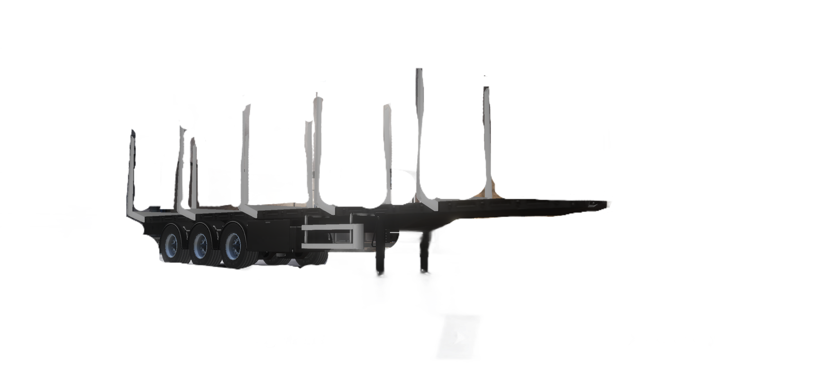
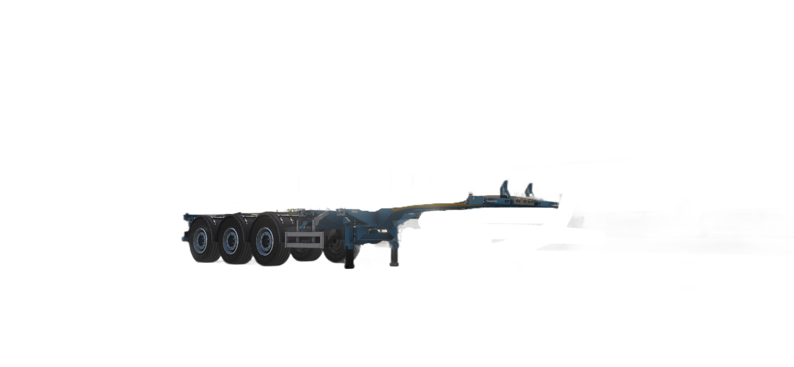
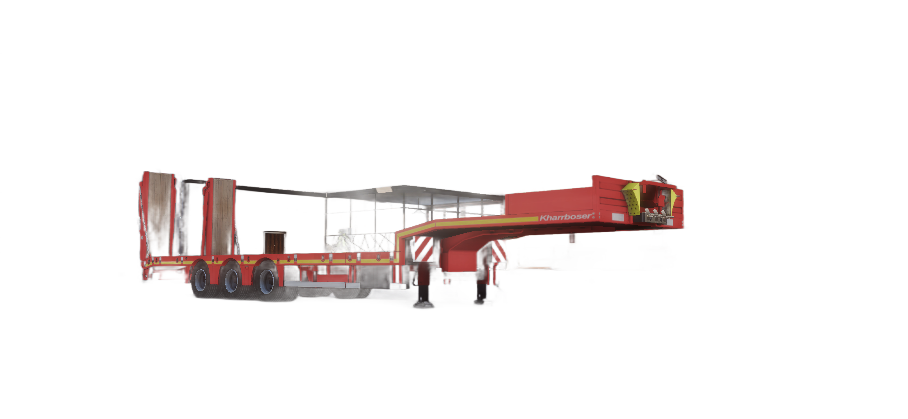
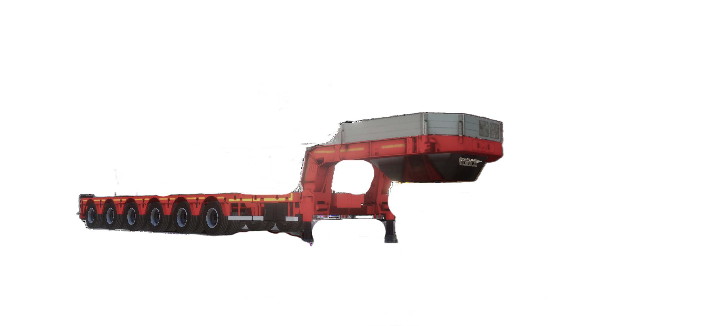
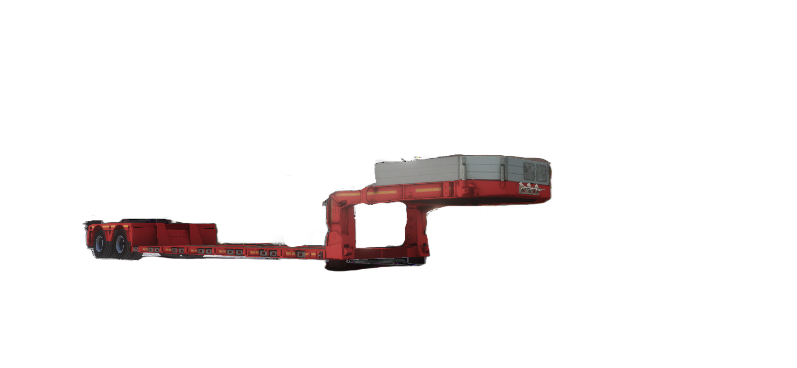
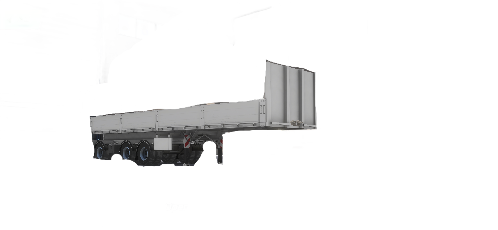
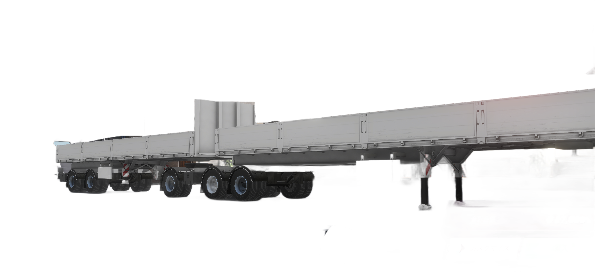
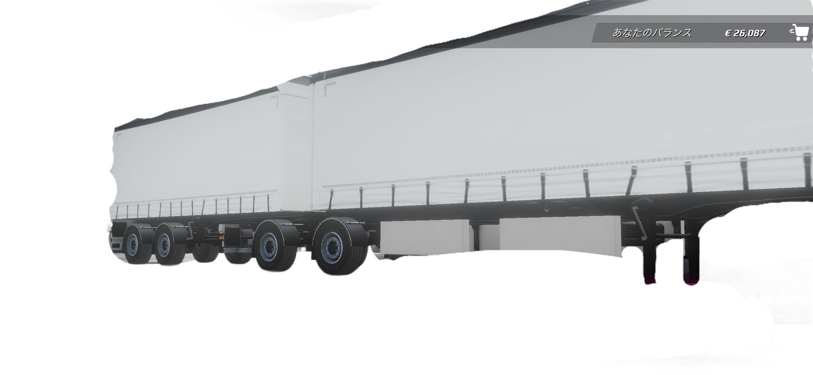
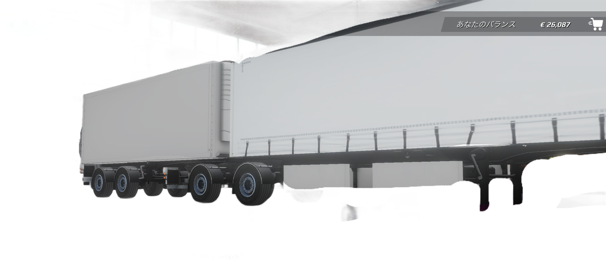



[Japanese Ver](/vehicles/trailer-customization/)

# Trailer Customization

You can customize trailers as follows:

- Color and Skin
- Wheels
- Chassis

___
## Vehicles That Cannot Have Skins Applied

- Log Trailer
   
- Gooseneck
    
- Fixed Lowbed
    
- Lowbed
    
- Oversize
    

Skins can be applied to the other 16 vehicles.
Color customization is available for all vehicles.

___
## Wheel Customization

### Vehicles that can switch between NW#1 and NW#2

- Curtain Side
- Curtain Side 2
- Closed Box
- Refrigerated
- Double Tarp
- Double Refrigerated
- Flatbed
- Brick Trailer
- Log Trailer
- Gooseneck
- Tanker
- Cistern Trailer
- Cement Bulker
- Mixer
- inLoader
- Scrap Trailer
- Tipper Trailer

### Vehicles Compatible Only with HW

- Open 
- Double Open 
- Fixed Lowbed 
- Lowbed 
- Oversize 

___
## Vehicles Supported for Chassis Customization

| Trailer Name | Chassis |
|---|---|
| Double Tarp  | Short / Medium / Long |
| Double Refrigerated  | Short / Medium / Long |
| Fixed Lowbed  | 3x0 / 4x0 / 5x0 / 6x0 |
| Lowbed  | 6x0 / 8x0 |
| Oversize  | 2x0 / 3x0 / 3x1 / 4x2 / 5x3 |

The remaining 16 vehicles cannot have their chassis modified.

> ⚠️ If you upgrade an Oversize trailer to 5x3, you’ll only be able to accept jobs in the three cities of Zurich, Munich, and Stuttgart.
> Since you can accept jobs in other cities with configurations other than 5x3, it’s fine to revert to a different configuration.  
> ⚠️ Because the Oversize (5x3) is nearly twice as long as other trailers,
> you may encounter difficulties driving on certain roads or during loading.
> Extra caution is required when driving.
