

[Japanese Ver](/vehicles/trailer/)

# Trailer Encyclopedia

There are 25 types of trailers in Truckers of Europe 3,  
and 22 of them are available for purchase.  
Below is a list of the available trailers.

| Image | Trailer Name | Price | Cargo | Level Restriction |
|---|---|---|---|---|
| 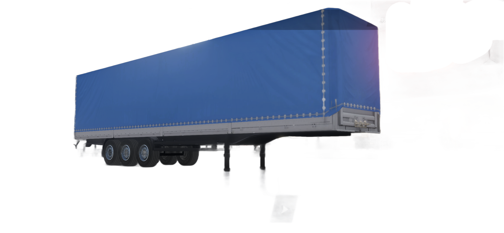 | Curtain Side | €4,000 | Food | 　|
| 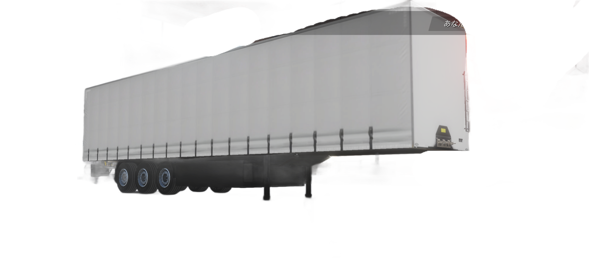 | Curtain Side 2 | €13,000 | Food | |
| 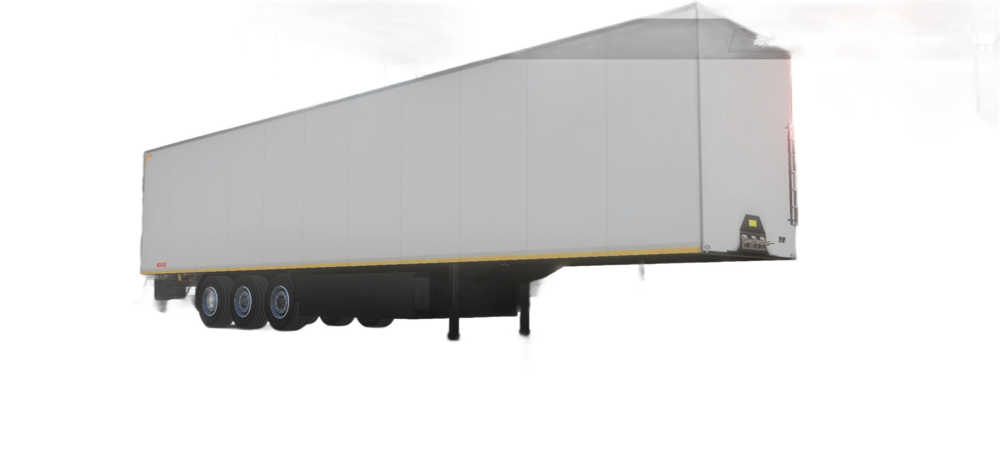 | Closed Box | €12,000 | Fruit |  |
| 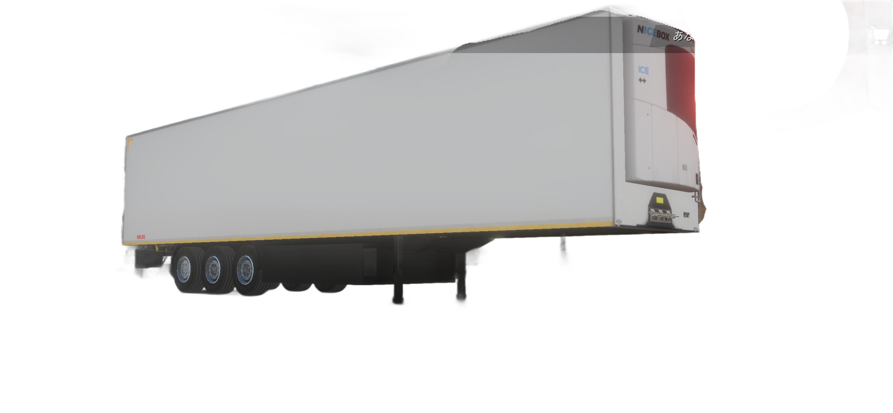 | Refrigerated | €17,000 | Food |  |
| 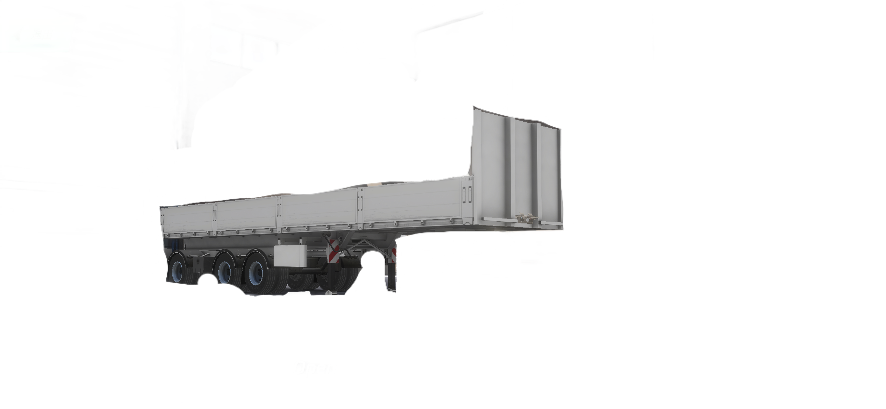 | Open | €18,000 | Building Materials | 2 |
| 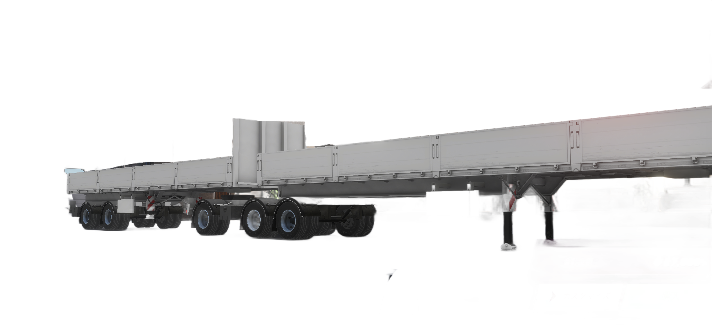 | Double Open | €27,000 | Building Materials | 2 |
| 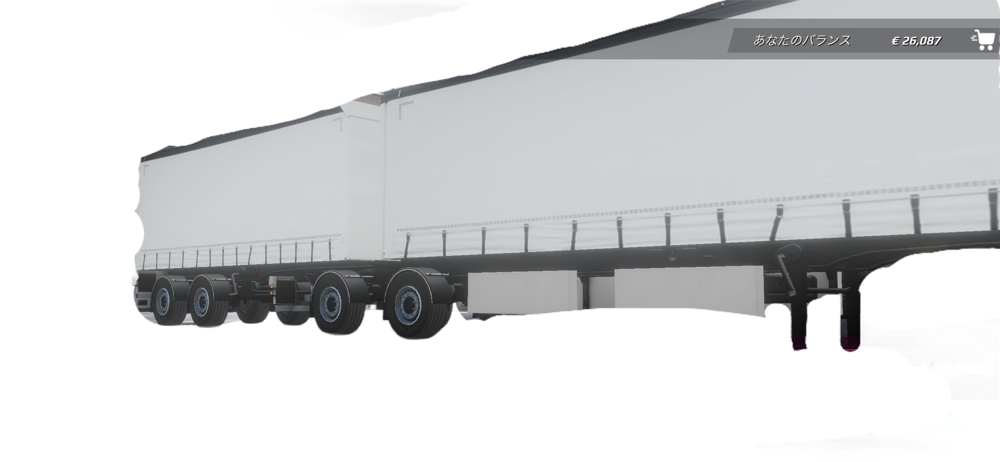 | Double Tarp | €30,000 | Food |  |
| 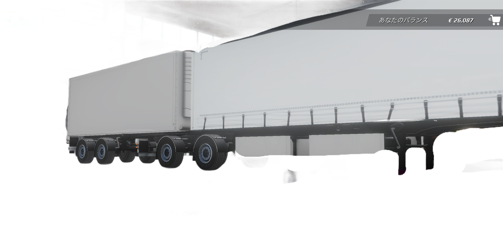 | Double Refrigerated | €35,000 | Food | |
| 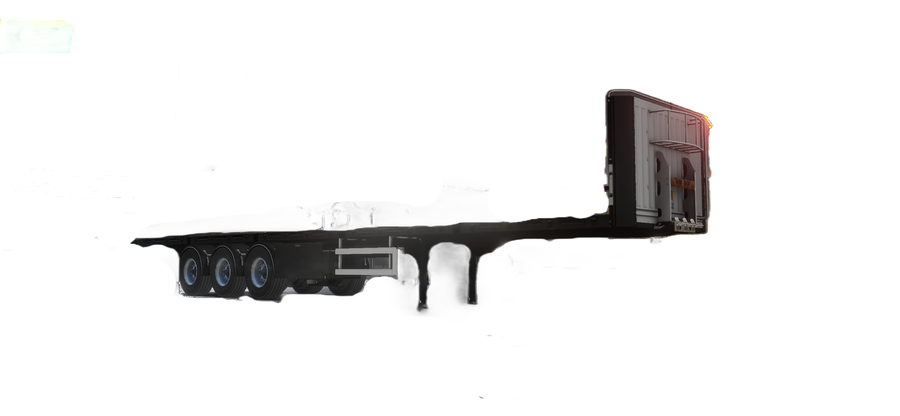 | Flat Bed | €22,000 | Building Materials (Heavy) | 　|
| 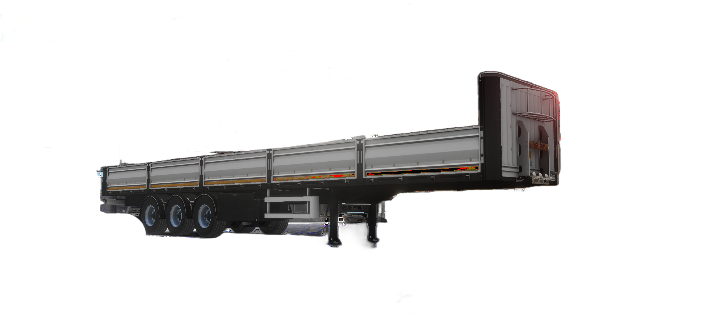 | Brick Trailer | €25,000 | Stone |  |
| 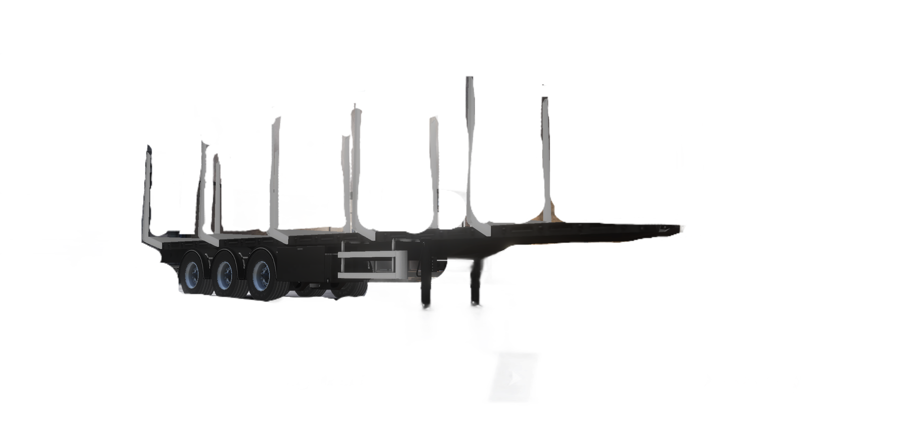 | Log Trailer | €20,000 | Lumber | 3 |
| 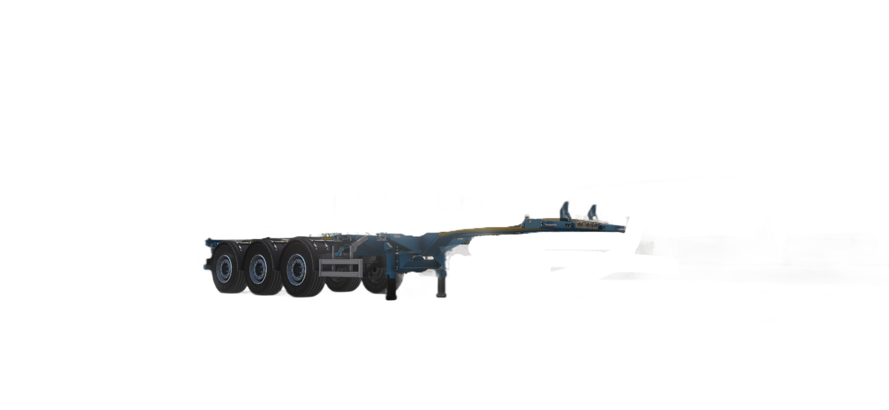 | Gooseneck | €10,000 | Daily Necessities | 　|
| 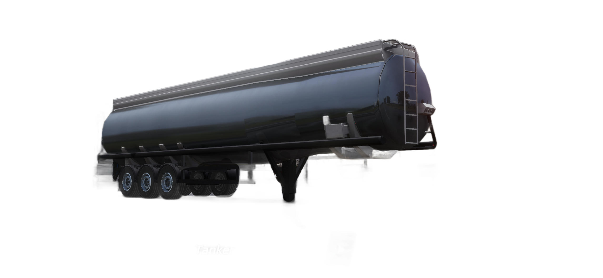 | Tanker | €12,000 | Fuel | 3 |
| 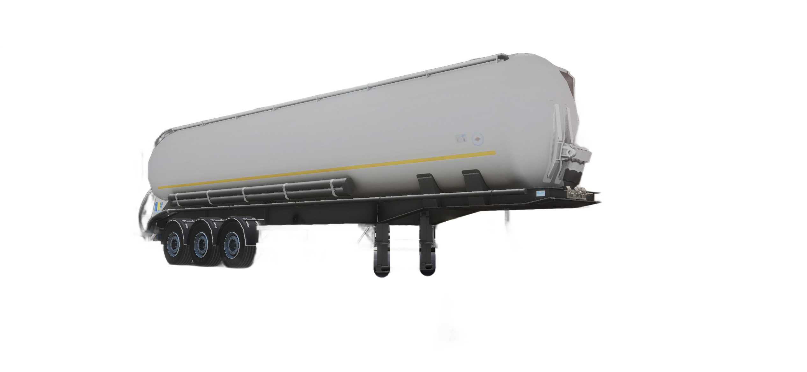 | Cistern Trailer | €22,000 | Glucose, Vegetable Oil |  |
| 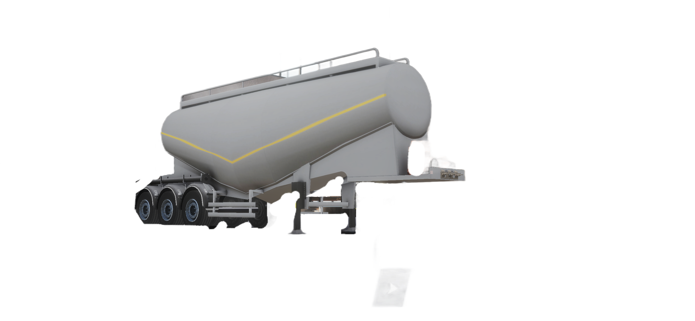 | Cement Bulker | €23,000 | Cement | 3 |
| 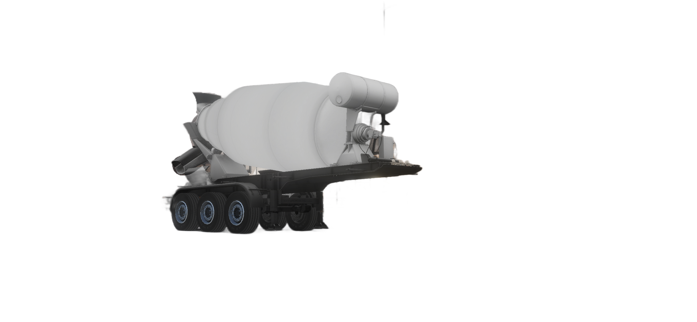 | Mixer | €20,000 | Cement | 5 |
| 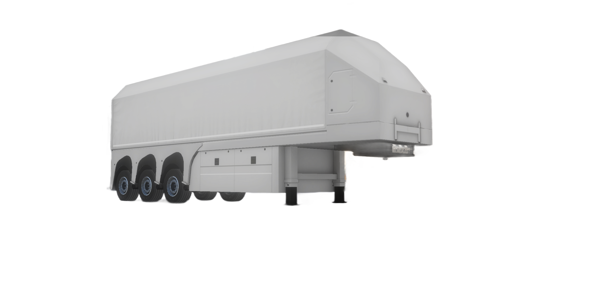 | inLoader | €12,000 | Building Materials | 2 |
| 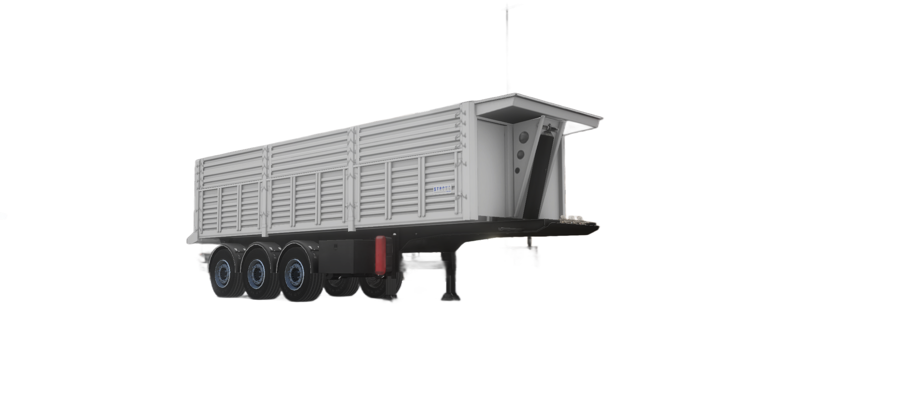 | Scrap Trailer | €15,000 | Stone | 2 |
| 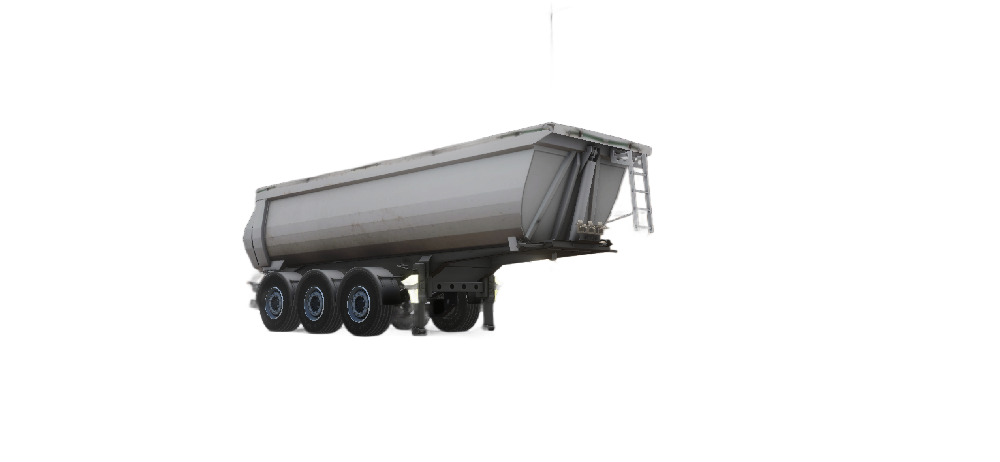 | Tipper Trailer | €20,000 | Stone | 2 |
| 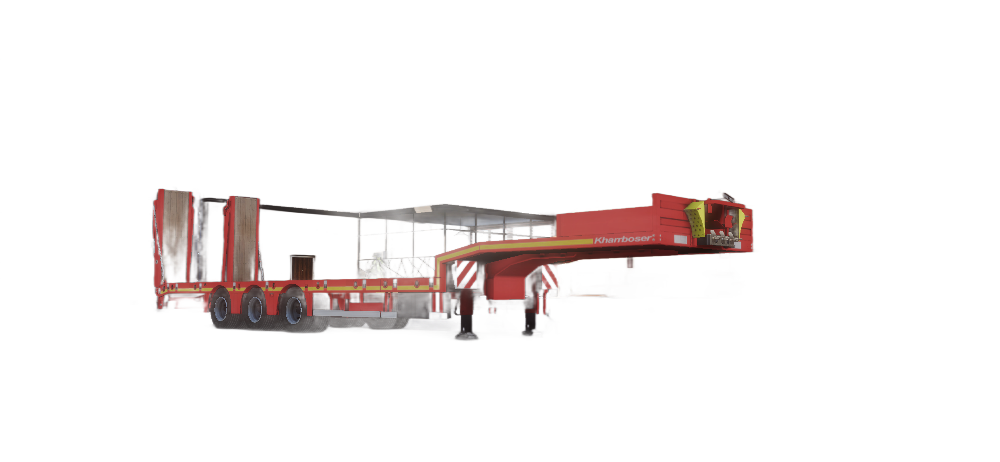 | Fixed Lowbed | €30,000 | Heavy Equipment | 7 |
| 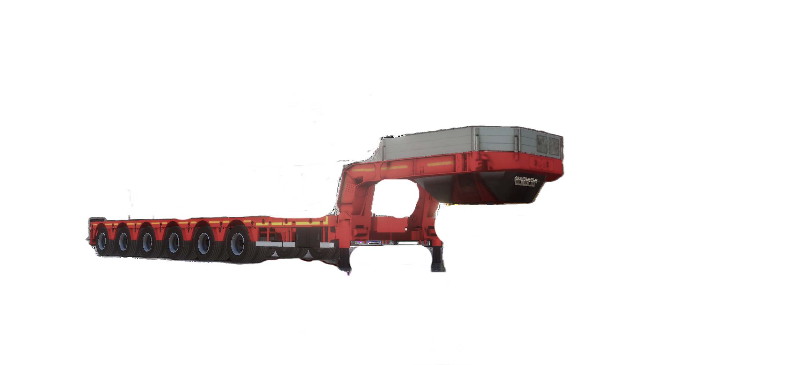 | Lowbed | €36,000 | Heavy Equipment | 12 |
| 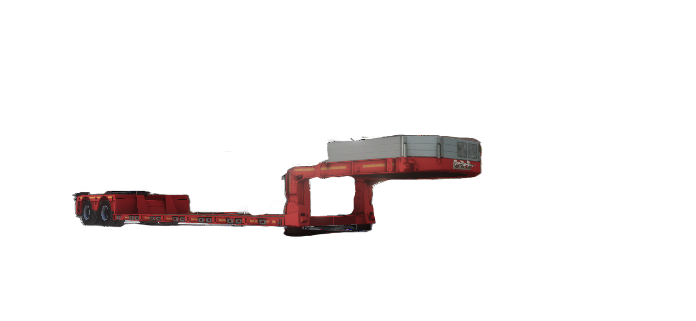 | Oversize | €30,000 | Heavy Equipment | 12 |

___
## Heavy-Load Trailers

Since these trailers carry loads of 20 to 30 metric tons or more, we recommend upgrading the truck’s engine and chassis through customization.
For more details, see [Truck Customization](/vehicles/truck-customization/).

| Image | Trailer Name | Price | Cargo | Level Restriction |
|---|---|---|---|---|
|  | Flat Bed | €22,000 | Building Materials (Heavy) | 　|
|  | Brick Trailer | €25,000 | Stone | |
|  | Log Trailer | €20,000 | Lumber | 3 |
|  | Fixed Lowbed | €30,000 | Heavy Equipment | 7 |
|  | Lowbed | €36,000 | Heavy Equipment | 12 |
|  | Oversize | €30,000 | Heavy Equipment | 12 |

___
## Recommended Trailers for the Early Game

| Image | Trailer Name | Price | Cargo | Level Limit |
|---|---|---|---|---|
|  | Curtain Side | €4,000 | Food |  |

___
## Recommended Trailers for Level 12 and Above

| Image | Trailer Name | Price | Cargo | Level Restriction |
|---|---|---|---|---|
|  | Oversize | €30,000 | Heavy Equipment | 12 |

This is the trailer with the highest job rewards in the game. We recommend customizing the chassis to “5x3” to earn even more.

> ⚠️ Since the Oversize (5x3) is nearly twice as long as other trailers,
> you may have difficulty driving it on certain roads or when loading cargo.
> Extra caution is required when driving.

___
## Trailer Customization

Trailers can also be customized. For details, see [Trailer Customization](/en/vehicles/trailer-customization/).
