

[Japanese Ver](/vehicles/truck/)

# Truck Encyclopedia

Truckers of Europe 3 features a total of 15 different truck models.  
Below is a list of their names and specifications.
> The specifications in this list are for the stock vehicles only;  
> most trucks can be upgraded to these same specifications through customization.

___
## Complete Truck List

| Image | Truck Name | Price | Horsepower | Torque |
|---|---|---|---|---|
| 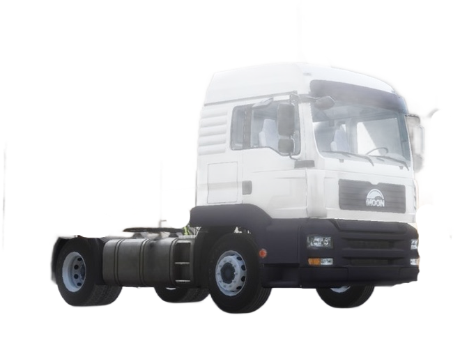 | Moon THA | €9,000 | 310hp | 1,550Nm |
| 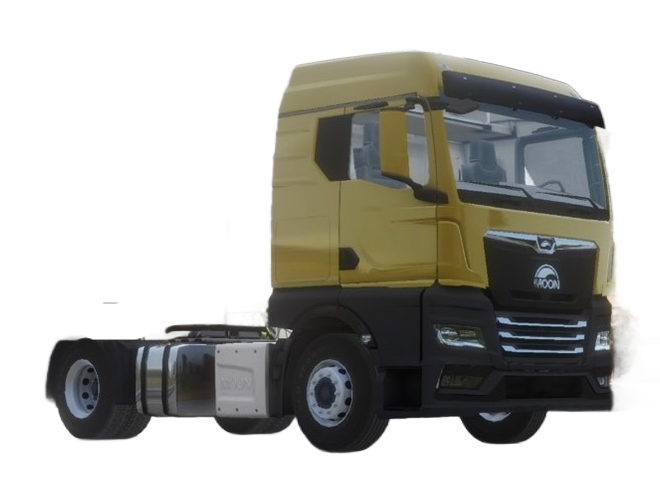 | Moon THX | €35,000 | 360hp | 1,800Nm |
| 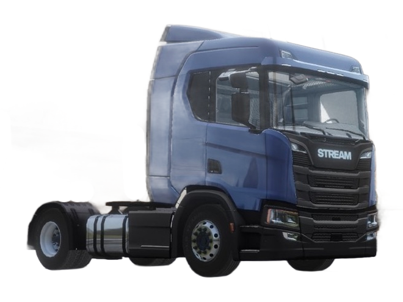 | Stream RT | €35,000 | 370hp | 1,900Nm |
| 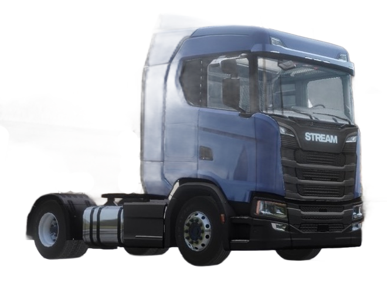 | Stream ST | €36,000 | 370hp | 1,900Nm |
| 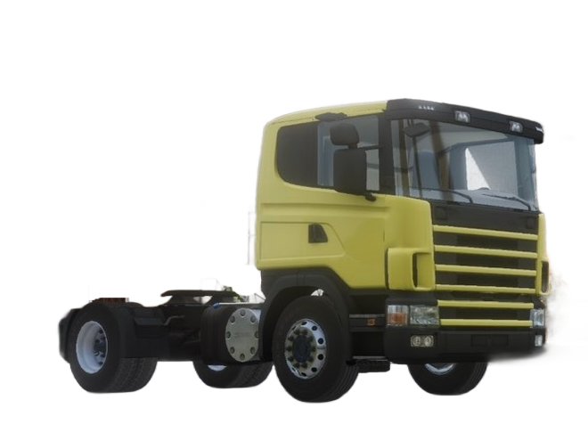 | Stream RT Legend 1995 | €10,000 | 380hp | 1,900Nm |
| 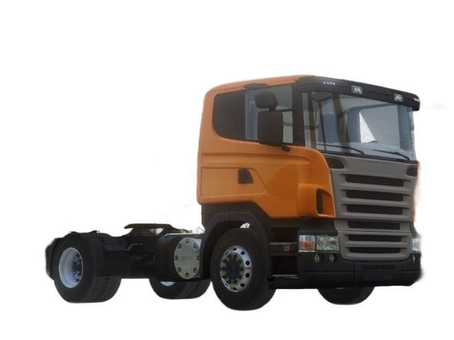 | Stream RT Legend 2004 | €15,000 | 380hp | 1,900Nm |
| 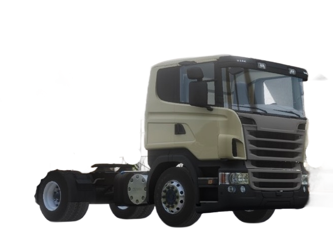 | Stream RT Legend 2009 | €20,000 | 380hp | 1,900Nm |
| 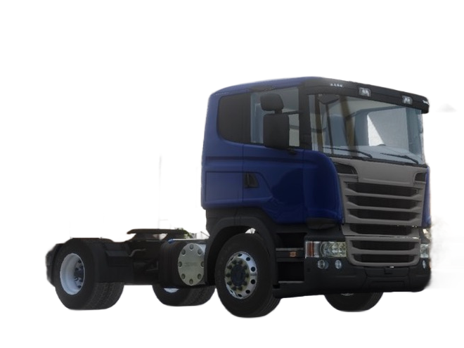 | Stream RT Legend 2013 | €25,000 | 370hp | 1,900Nm |
| 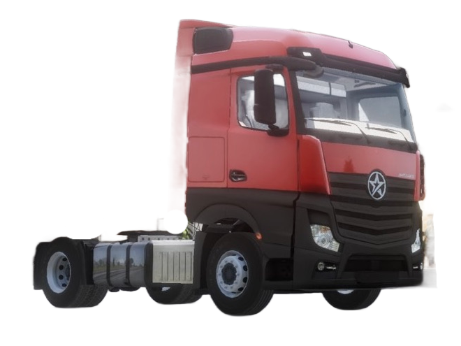 | Merieles Antares | €34,000 | 420hp | 2,100Nm |
| 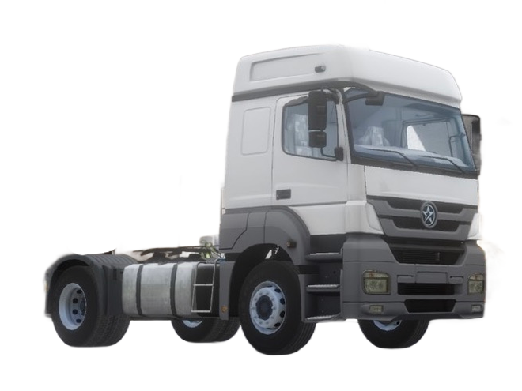 | Merieles Arox | €18,000 | 326hp | 1,300Nm |
| 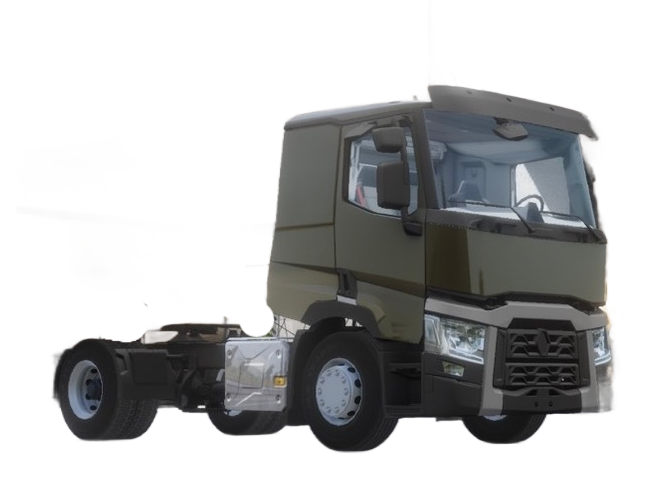 | Renovate R Ranger 2013 | €27,000 | 380hp | 1,800Nm |
| 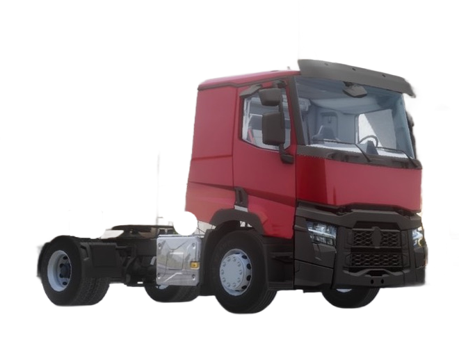 | Renovate R Ranger 2021 | €30,000 | 380hp | 1,800Nm |
| 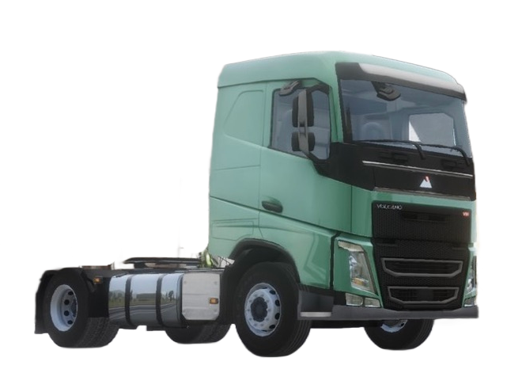 | Volcano VN | €32,000 | 420hp | 2,100Nm |
| 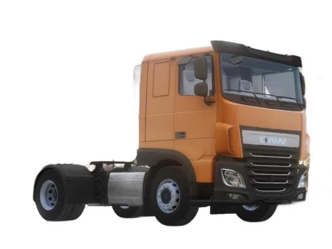 | DAWN DF | €32,000 | 370hp | 1,900Nm |
| 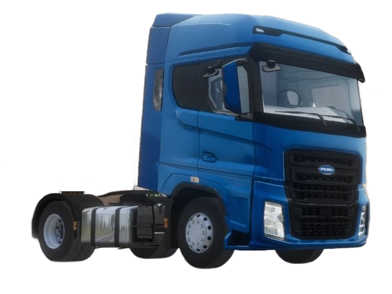 | Fiora Fi-Man | €30,000 | 500hp | 2,500Nm |

___
## Recommended Trucks You Can Use Right from the Start

| Image | Truck Name | Price | Horsepower | Torque |
|---|---|---|---|---|
| 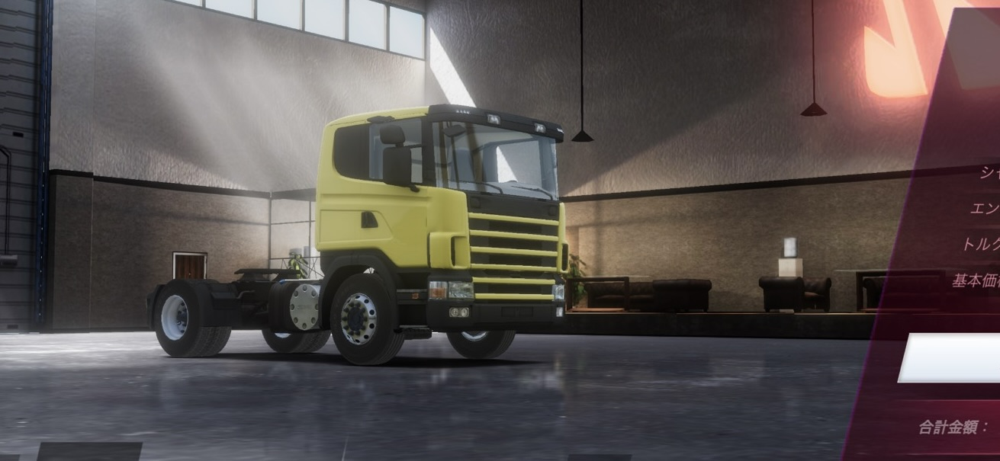 | Stream RT Legend 1995 | €10,000 | 380 hp | 1,900 Nm |

Not only does it offer great value for money—you can buy it with just €10,000 in starting funds—but it can also handle heavy loads, making it a great choice for advanced players.

___
## ⚠️Warning: Trucks Unsuitable for Transporting Heavy Cargo

While all trucks except these two support chassis customization,
only these two have limitations; even when fully upgraded, they struggle to transport heavy cargo.

| Image | Truck Name | Price | Horsepower | Torque |
|---|---|---|---|---|
|  | Moon THA | €9,000 | 310hp | 1,550Nm |
|  | Fiora Fi-Man | €30,000 | 500hp | 2,500Nm |

For more details, see [Truck Customization](/en/vehicles/truck-customization/).

---
## Ground　Clearance

Ground clearance varies significantly depending on the truck, and you can see that difference clearly in the image below.

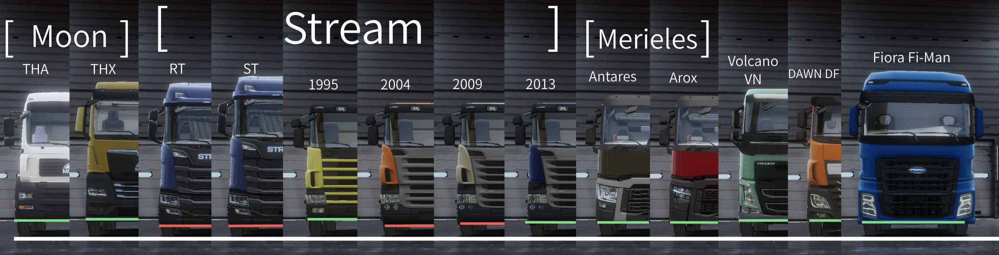

> ##### This image is a comparison image created exclusively by this site. It is not an officially released image.

The following trucks have particularly low ground clearance, so the underside of the vehicle often hits the ground during off-road driving.
Since they are also more prone to getting stuck, we recommend exercising a little caution when choosing a truck.

| Image | Truck Name | Price | Horsepower | Torque |
|---|---|---|---|---|
|  | Stream RT | €35,000 | 370hp | 1,900Nm |
|  | Stream ST | €36,000 | 370hp | 1,900Nm |
|  | Stream RT Legend 2004 | €15,000 | 380hp | 1,900Nm |
|  | Stream RT Legend 2009 | €20,000 | 380hp | 1,900Nm |

## Summary

While specifications vary by vehicle,  
our top recommendation is the truck you like best.  
Have fun playing the game with your partner!
