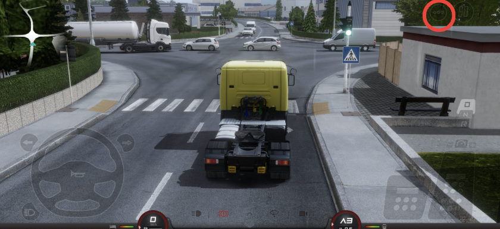
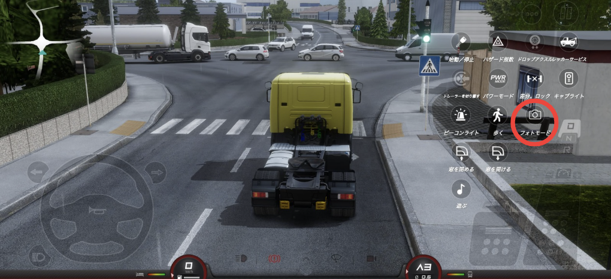
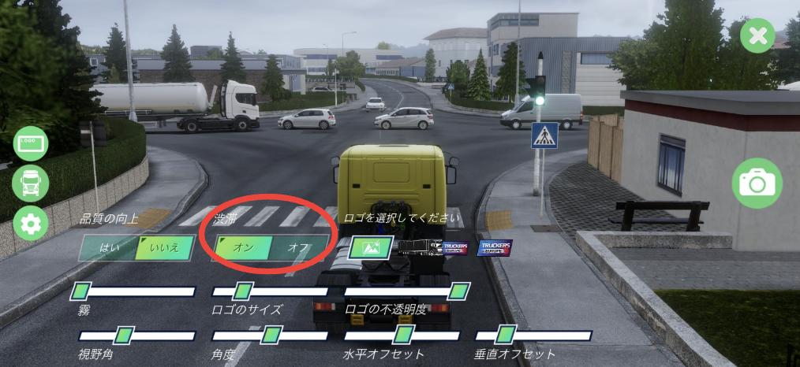
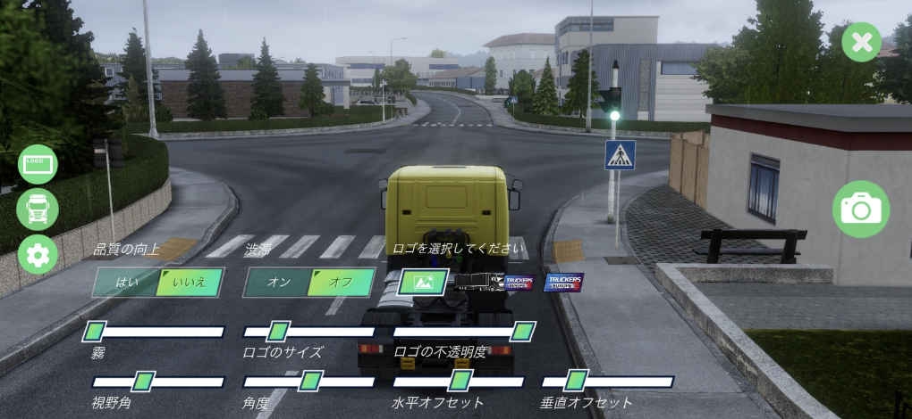

# 小技・小ネタ集

[English Ver](/en/guides/tips/)

___
## 最速でレベル上げする方法

全てのジョブで経験値は一回800xpです。そのためできるだけ短距離のジョブだけを繰り返すと最速です。

___
## 雨を止ませる方法

雨が降っていると、路面が滑る、視界が悪くなる、トラックが汚れるなど不便な点も多いです。
一度メインメニューに戻ってから再度プレイし直すと、天気が晴れになります。

___
## ガレージに洗車機を追加する方法

ガレージレベルを最大まで上げるとガレージが広くなり、敷地内に洗車機が追加されます。

___
## 渋滞を消す方法

このゲームはよく渋滞します。右上の「⋯」ボタンから  
 
フォトモードを開き、 
 
「traffic」もしくは「渋滞」をオフにするとすべてのNPC車両が消えます。 
 
 
>フォトモード中はパーキングブレーキが作動するため、運転中に使うと危険です。

___
## NPC車両をどかす方法

狭い道で追い越したいけど追い越せない時、クラクションかパッシング(画面左下ボタン)をすると前にいるNPC車両がわずかに横によけてくれます。

___
## ゲーム内時間

このゲーム内では、現実世界の12倍の速さで時間が流れていきます。  
また、日の出は5:00、日の入は20:00です。

---
## 緊急ブレーキ

駐車ブレーキはフットブレーキをフルブレーキでかけるよりも強烈です。
普段使いにはおすすめできませんが、道を間違えた時やぶつかりそうな時の緊急ブレーキとして役立つかもしれません。
