[English Ver](/en/jobs/job-list/)

# 観測済みジョブ一覧

このゲームに存在するジョブの傾向や一覧を調べるため当記事では約3,000件のジョブデータを収集しました。
このページではその収集で得られたデータから、このゲームのジョブについて深掘りしていきます。

調査の範囲：ガレージのある9都市・2,889件・所有トレーラーなし・バージョン0.70.64・調査実施日2026/10/28


この一覧は、実際のゲームプレイから観測できたジョブの全種類です。ゲームファイルの解析ではないため、特殊条件や低確率（仕様やバグ）のジョブが存在しないとは言い切れず、この一覧に存在しないジョブが存在するかもしれません。
報酬倍率は、同じ出発地＞目的地の基準報酬（重さ40 t以下・要求レベルがレベル30以外のジョブの中央値）に対する倍率です。


※ は観測数が5件未満の暫定値です。

## ① 40 t未満（観測は39 tまで）

| 貨物 | 要求レベル | 重さ | 報酬倍率 |
|---|---|---|---|
| 服 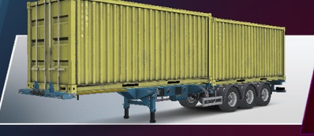 | なし | 8〜15 t | 約1.00 |
| 薬 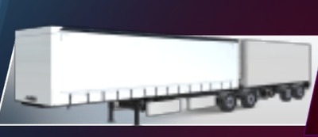 | なし | 9〜12 t | 約1.00 |
| 野菜 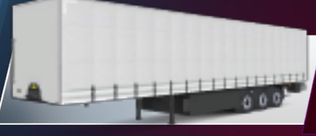 | なし | 9〜19 t | 約1.00 |
| 果物 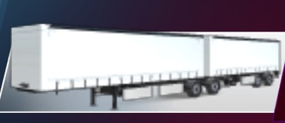 | なし | 9〜20 t | 約1.00 |
| 缶詰  | なし | 9〜23 t | 約1.00 |
| 飲料 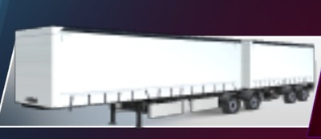 | なし | 11〜21 t | 約1.00 |
| 食べ物  | なし | 12 t | 約1.00 |
| 書籍 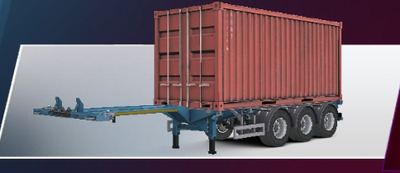 | なし | 12〜14 t | 約1.00 |
| アイスクリーム 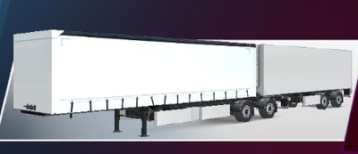 | なし | 13 t | 約1.00 |
| フルーツジュース 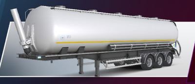 | なし | 13 t | 約1.00 |
| 大理石 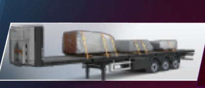 | なし | 13〜18 t | 約1.00 |
| 牛乳  | なし | 14 t | 約1.00 |
| 鉄筋 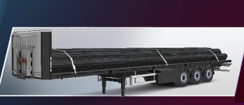 | なし | 15 t | 約1.00 |
| 自動車部品  | なし | 16〜26 t | 約1.00 |
| 植物油  | なし | 17 t | 約1.00 |
| 肉 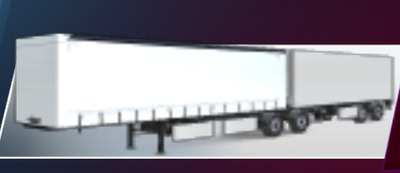 | なし | 18 t | 約1.00 |
| 魚  | なし | 18 t | 約1.00 |
| 金属パイプ 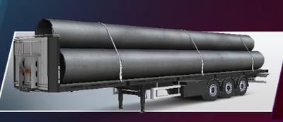 | なし | 18 t | 約1.00 |
| 木の板 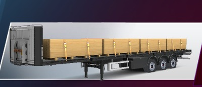 | なし | 19 t | 約1.00 |
| グルコース  | なし | 19 t | 約1.00 |
| 石膏バッグ 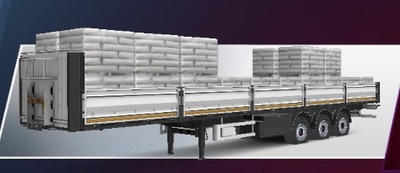 | なし | 19 t | 約1.00 |
| コンクリートブロック 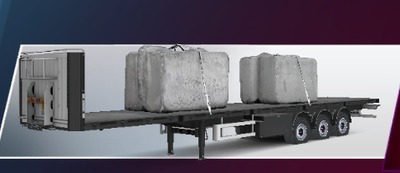 | なし | 19 t | 約1.00 |
| 肥料袋 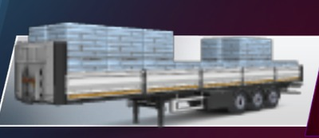 | なし | 20 t | 約1.00 |
| チーズ  | なし | 21 t | 約1.00 |
| エレクトロニクス  | なし | 21 t | 約1.00 |
| セメントバッグ 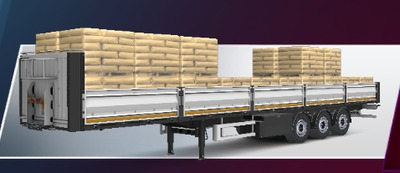 | なし | 23 t | 約1.00 |
| コンクリートバリア 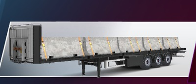 | なし | 26 t | 約1.00 |
| ケーブルリール 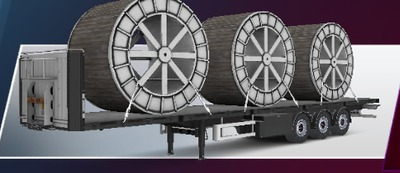 | なし | 29 t | 約1.00 |
| ボイラー 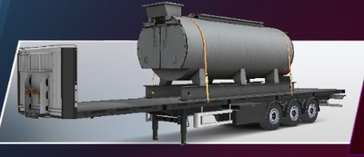 | なし | 34 t | 約1.00 |
| 石膏バッグ  | 2 | 12〜17 t | 約1.00 |
| 石炭 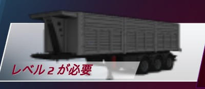 | 2 | 14 t | 約1.00 |
| 砂  | 2 | 15 t | 約1.00 |
| コンクリートブロック  | 2 | 15 t | 約1.00 |
| 敷石 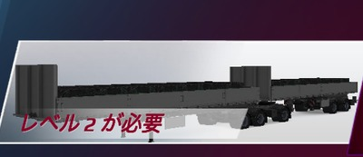 | 2 | 15〜22 t | 約1.00 |
| 砂利 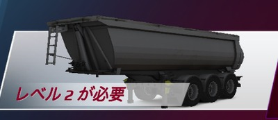 | 2 | 16 t | 約1.00 |
| スクラップメタル  | 2 | 17 t | 約1.00 |
| 機械部品 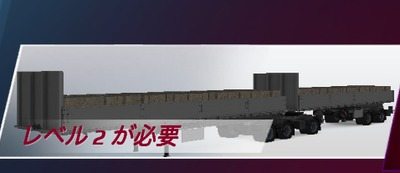 | 2 | 18〜26 t | 約1.00 |
| セメント袋 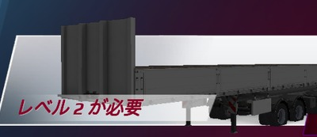 | 2 | 20〜25 t | 約1.00 |
| ストーンズ 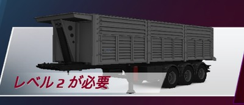 | 2 | 21 t | 約1.00 |
| レンガ 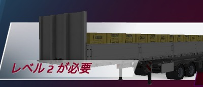 | 2 | 25〜32 t | 約1.00 |
| 砒素 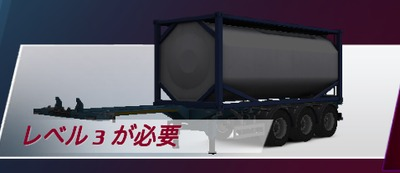 | 3 | 8〜16 t | 約1.00 |
| 汚染物質  | 3 | 9〜18 t | 約1.00 |
| 塩化  | 3 | 9〜19 t | 約1.00 |
| 農薬 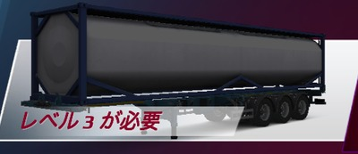 | 3 | 10〜15 t | 約1.00 |
| 医療廃棄物  | 3 | 10〜18 t | 約1.00 |
| 油 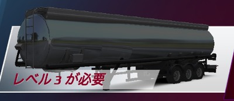 | 3 | 15 t | 約1.00 |
| シアン化物  | 3 | 16〜17 t | 約1.00 |
| 燃料油  | 3 | 18 t | 約1.00 |
| ガソリン  | 3 | 21 t | 約1.00 |
| ディーゼル  | 3 | 24 t | 約1.00 |
| セメント 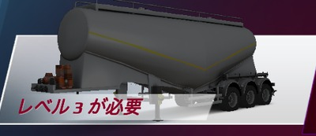 | 3 | 25 t | 約1.00 |
| ログ 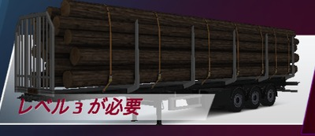 | 3 | 26 t | 約1.00 |
| シアン化物  | 4 | 7 t | 約1.00 |
| ガラス 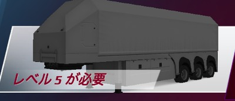 | 5 | 14 t | 約1.00 |
| セメント  | 5 | 14 t | 約1.00 |
| スキッドステア 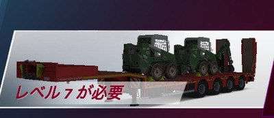 | 7 | 14〜16 t | 約1.00 |
| モーターグレーダー 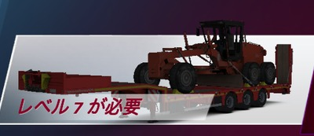 | 7 | 18 t | 約1.00 |
| 掘削機 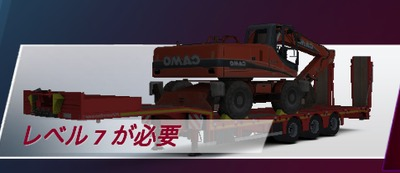 | 7 | 25〜27 t | 約1.00 |
| クレーン車 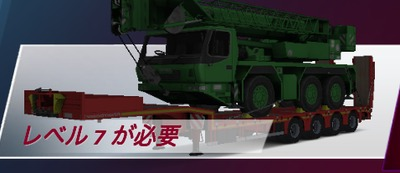 | 7 | 38 t | 約1.00 |
| フロントローダー 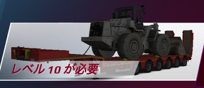 | 10 | 28 t | 約1.00 |
| アスファルト舗装 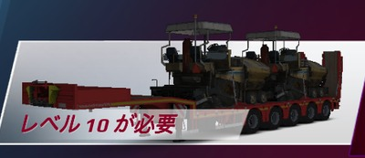 | 10 | 35 t | 約1.00 |
| 掘削機  | 12 | 26 t | 約1.00 |
| 発電機部品 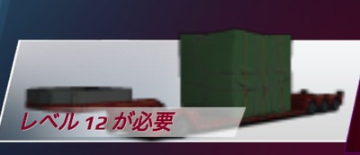 | 12 | 37 t | 約1.00 |
| 機械部品  | 12 | 39 t | 約1.00 |
| 工業用サイロ 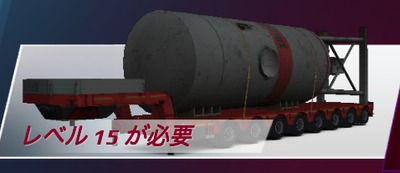 | 15 | 19〜21 t | 約1.00 |
| 重いトラクター 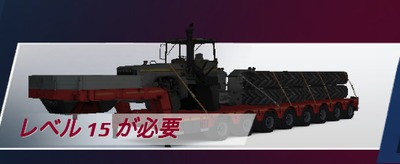 | 15 | 35 t | 約1.00 |
| タービンモーター 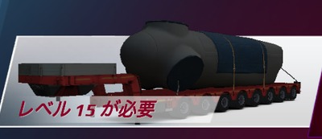 | 15 | 36 t | 約1.00 |

___

## ② 40 t超

| 貨物 | 要求レベル | 重さ | 報酬倍率 |
|---|---|---|---|
| ロードローラー 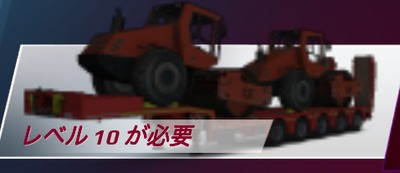 | 10 | 41 t | 約1.83 |
| 機械部品  | 10 | 45 t | 約1.90 |
| アーティキュレートトラック 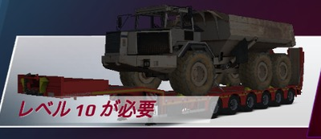 | 10 | 53 t | 約1.99 |
| 自動車部品  | 12 | 42〜49 t | 約1.84〜1.99 |
| 発電機部品  | 12 | 42〜55 t | 約1.85〜1.99 |
| 機械部品  | 12 | 47〜62 t | 約1.94〜1.99 |
| ケーブルリール  | 12 | 82 t | 約1.99 |
| マイニングトラックの部品 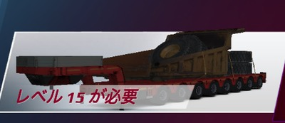 | 15 | 63 t | 約1.99※ |
| ワゴン 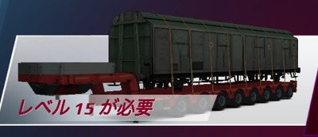 | 15 | 72〜76 t | 約1.99〜2.00 |
| ワゴン  | 17 | 128 t | 約2.00 |

___

## ③ 要求レベル30

| 貨物 | 要求レベル | 重さ | 報酬倍率 |
|---|---|---|---|
| 農業機械 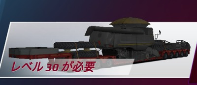 | 30 | 23 t | 約1.40 |
| 重いクレーン 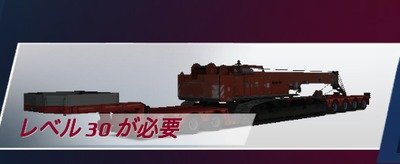 | 30 | 42 t | 約2.59※ |
| トランスフォーマー 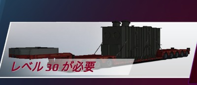 | 30 | 49 t | 約2.74※ |
| マイニングトラックシャーシ  | 30 | 53 t | 約2.81※ |
