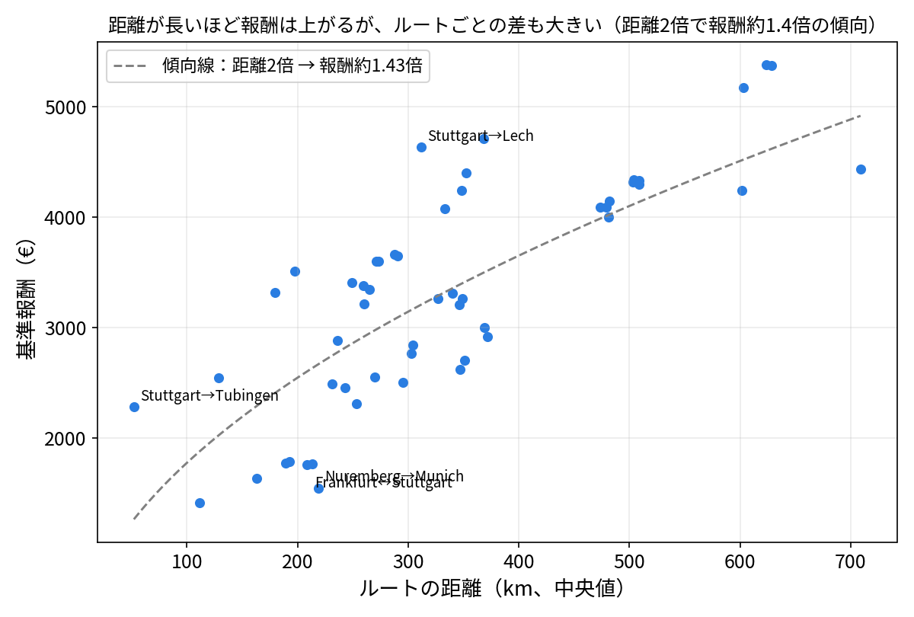
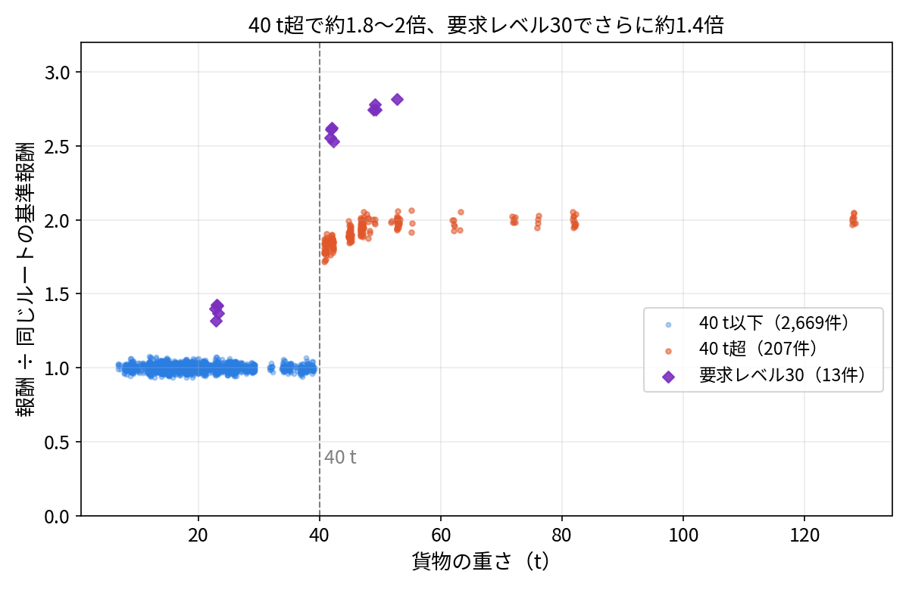


【骨子ファイル】このブロックと、同じ形のブロックで囲んだ部分は、ページには表示されません（メモ用）。
英語版を公開したら、次の1行を有効にしてください（先に有効にするとリンク切れになります）。
[English Ver](/en/jobs/reward-mechanics/)


# ジョブ報酬の決まり方  -約3,000件のジョブからの独自検証でわかったこと-

このサイトでは独自に2,889件のジョブからこのゲームのジョブの特徴や、存在するあらゆるジョブについて調べました。
このページでは、この独自検証からわかったジョブ報酬が決まる法則について解説します。
 > 調査の実施はバージョン0.70.64ですが、今後のアップデートでは仕様が変更される可能性もあります。
___

## 結論

- （① 報酬は、出発地＞目的地のルートでほぼ決まる）
- （② 重さ40 t以下は、貨物や重さに関係なく同額）
- （③ 40 t超で約1.8〜2倍、要求レベル30でさらに約1.4倍）

___

## 調査の範囲

| 項目 | 内容 |
|---|---|
| ゲームのバージョン | ver0.70.64 2026/11時点で最新版 |
| 出発地 | 9地点（Frankfurt、Milano、Munich、Nancy、Nuremberg、Prague、Stuttgart、Tremola、Zurich） |
| 件数 | スクリーンショット1,031枚から、重複などを除いた2,889件 |
| トレーラー | 所有なし |
| 基準報酬 | 同じルートの、重さ40 t以下・要求レベル30でないジョブの中央値 |

> ⚠️ガレージの存在しない他5都市を検証しなくても全都市のジョブについて調べることができたので、
この検証ではガレージのある9都市からのみ検証しました。
また、この検証はゲームファイルの解析ではなく、実際にゲームを起動し行なったもので、特殊な条件や仕様を見つけきれていない可能性が否定できません。あくまでこのサイト独自の検証であって公式情報ではないことをご了承ください。

___

## 1. 報酬はルートでほぼ決まる


入れる数字：ルートだけで報酬の変動の77.9%、ルート×40 t超かで99.3%、さらにレベル30で99.6%。
往復は同額：出発地と目的地を入れ替えた類似条件のジョブで報酬の比の平均が1.00（0.95〜1.03）。
距離：ルート単位で、距離が2倍→報酬は約1.4倍。同じルートでは、その1件の距離が1%長いと報酬が約0.39%増。
図：chart_route_distance_vs_reward.png（下の画像の行を有効にする）
注意：ルートごとの個別の差が大きい（例：Stuttgart→Tubingenは52 kmで€2,284）。


距離が長い方が報酬も高くなる傾向は一応ありますが、その幅はそれぞれのルートによって大きく異なります。

<!--  -->

___

## 2. 重さ40 t以下は、貨物に関係なく同額


入れる数字：倍率1.00（95%の範囲0.97〜1.03）、2,669件、貨物61種類。
検定：貨物（58種類）の効果 p＝0.125、重さ（40 t以下）との相関0.03（p＝0.42）。「差が見つからない」であって、「差がない証明」ではない。
重さの変動：固定の貨物41種類、変動する貨物28種類（幅の中央値8 t）。
図：chart_weight_vs_reward_ratio.png（40 t以下は、1.00に集まる）


この条件に当てはまるジョブのグループでは、貨物の種類やトレーラーに関わらず、すべてのジョブで報酬倍率がほぼ同じです。

<!--  -->

___

## 3. 40 t超は約1.8〜2倍

| 重さ | 倍率 | 件数 | 貨物 |
|---|---|---|---|
| 41 t | 約1.83 | 33 | ロードローラー |
| 42 t | 約1.84 | 23 | 自動車部品、発電機部品 |
| 45 t | 約1.90 | 36 | 機械部品、自動車部品 |
| 47 t | 約1.95 | 38 | 自動車部品、機械部品 |
| 48 t以上（11通り） | 約1.97〜2.00 | 77 | 発電機部品、自動車部品、機械部品、アーティキュレートトラック、マイニングトラックの部品、ワゴン、ケーブルリール |


読み取り：41 tで約1.83、48 tで約1.99まで上がり、それ以降は約2.0で頭打ち（128 tも約2.0）。
同じ貨物でも、重さで倍率が変わる（機械部品、自動車部品、発電機部品、ケーブルリール）。
重量級は、全体の7.4%（215/2,889）。
注意：40 tぴったりのデータはなく、境界は「40 t以下」と「41 t以上」の間。


40tを超えると報酬が約2倍というかなり大きい差があります。もちろんその重さの分難易度は上がることがありますが、その難易度に見合った報酬です。
___

## 4. 要求レベル30はさらに約1.4倍

| 重さ | 倍率 | 件数 | 貨物 |
|---|---|---|---|
| 23 t | 約1.40 | 5 | 農業機械 |
| 42 t | 約2.59 | 4 | 重いクレーン |
| 49 t | 約2.74 | 3 | トランスフォーマー |
| 53 t | 約2.81 | 1 | マイニングトラックシャーシ |


上乗せは約1.4倍（同じ重さの通常の重量級に対して1.38〜1.41倍）。
注意：13件だけ。暫定の値として書く。


レベル30はそれなりに長い時間このゲームをプレイしていないとなかなか辿り着けない領域で、要求レベルが30のジョブはかなりレアなジョブですが、その分報酬は段違いです。距離が同じ40t未満のジョブの2倍から3倍も報酬が得られます。

___

## 活用のヒント


- 48 t以上は頭打ち（41 tで約1.83、48 t以上で約2.0）
- 40 t以下は、どのジョブを選んでも同じルートなら同額。距離の短いルートほど、100kmあたりの報酬が高い（150 km以下で約€1,950、150〜300 kmで約€1,000、300〜450 kmで約€910、450 km超で約€850）
- ジョブ選びは、貨物の種類より、ルートと重さを見る


___

## 調査の方法と限界


方法：スクリーンショットを、OCRで読み取り、2つのエンジンの結果を照合し、要確認の行を画像で確認。
限界：9地点だけ／所有トレーラーなしの条件／件数の少ない区分（レベル4は6件、レベル30は13件）／観察された値で、ゲームの設計値とは限らない／所有トレーラーがある場合の倍率は、別に検証予定。


（ここに本文）
