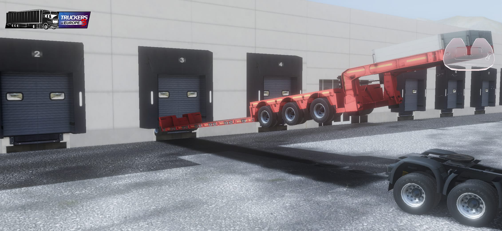

[English Ver](/en/troubleshooting/)

このカテゴリでは、現在のバージョンに存在する既知の不具合とその対処法をまとめます。 
ページに書かれていないバグや不具合があれば「お問い合わせ」よりメールいただけるとありがたいです。

___
## めり込み
 
何かにぶつかった際やスポーン時に起きることがあります。 
全く身動きできない場合「レッカーサービス」を使う必要があります。 
また、レッカーサービスを使用しても解決しない場合は、(もしジョブをやっている途中ならジョブをキャンセルし、)「ガレージに向かう」で自分のガレージにリスポーンすることが唯一の解決策です。
めり込んだのがトレーラーの場合は、「ガレージに向かう」ではなく、「トレーラーをガレージに送る」をする必要があります。

___
## 地面すり抜け

特にロード時に起きやすいです。 
トラックやトレーラーが地面よりも先に読み込まれてしまうことが原因です。 
未然に防ぐことはできませんが、数秒落下すると自動で地上にリスポーンできるため無害です。

___
## トレーラー表示バグ

ジョブ終了時や、貨物の積み込みをスキップした際に起きることがあります。 
例としてトレーラーの「Oversize」が「Lowbed」に置き換わったり、 
積んでいるはずの貨物が正常に表示されないことがあります。 
特に実害はありません。 
どちらも、一度メインメニューに戻るか、アプリを再起動することで直ります。

---
## レッカーサービス

レッカーサービスの使用時に、もといた場所から遠すぎる場所にスポーンしたりトレーラーを取り残してしまうことがあります。
完全にスタックして詰んでしまう場合もあります。
唯一の確実な解決策は、もしジョブの最中であってもジョブをキャンセルし、自分のガレージを選び「ガレージを訪問する」でガレージに移動することです。

---
## 迷子

レッカーサービスを使用した時や、道を間違えた時、マップのナビが正常に動作しなくなることがあります。
運転してもとの道に戻れるなら問題ありませんが、まったくわからなくなった場合は、レッカーサービスの不具合同様「ガレージを訪問する」でガレージに移動することが確実な解決策です。
